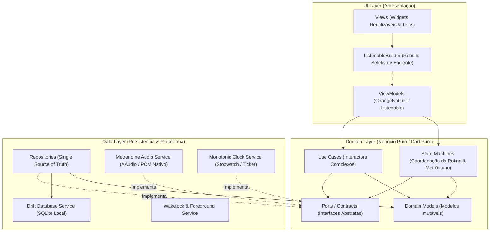
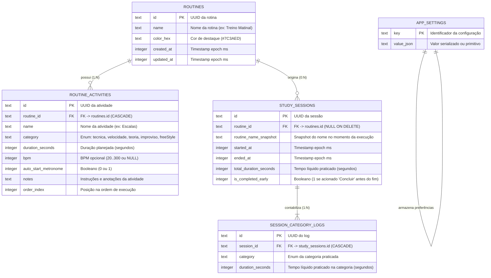
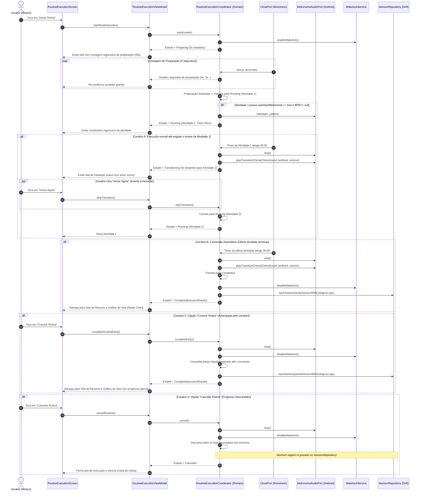

# Beatly — Documento de Decisão de Arquitetura (ADR.md)

| Metadado | Detalhe |
| :--- | :--- |
| **Projeto** | Beatly — Assistente Inteligente e Metrônomo de Estudos Musicais |
| **Documento** | Registro de Decisões de Arquitetura de Software (ADR.md) |
| **Etapa do Projeto** | Etapa 2 — Refinamento de Arquitetura |
| **Versão** | 1.0.0 |
| **Status** | Aprovado pelo Piloto |
| **Referência Funcional** | [SPEC.md](file:///home/souza/projects/beatly/SPEC.md) (v1.1.0) |
| **Diretrizes de Arquitetura** | [flutter-apply-architecture-best-practices](file:///home/souza/.gemini/config/plugins/flutter/skills/flutter-apply-architecture-best-practices/SKILL.md) |
| **Plataforma Alvo** | Android Nativo (Flutter / Dart, 100% Standalone & Offline-First) |

---

## 1. Visão Geral da Arquitetura em Camadas

A arquitetura do **Beatly** foi concebida para atender aos requisitos de alta precisão rítmica, isolamento de dados offline, manutenibilidade a longo prazo e desenvolvimento estritamente orientado a testes (**TDD - Test-Driven Development**).

Seguindo as diretrizes oficiais de arquitetura recomendadas para Flutter (MVVM com Separação Estrita de Responsabilidades), o sistema divide-se em três camadas primárias: **UI Layer (Apresentação)**, **Domain Layer (Lógica de Negócios e Domínio)** e **Data Layer (Acesso a Dados e Plataforma)**.



### 1.1. UI Layer (Apresentação)
- **Views**: Widgets declarativos e magros (`StatelessWidget` como padrão; `StatefulWidget` exclusivamente para transições de layout, controllers de animação ou ciclo de vida de scroll). Não realizam chamadas a banco nem executam cálculos matemáticos.
- **ViewModels**: Gerenciadores de estado reativo baseados em `ChangeNotifier`. Expõem estados imutáveis para a View através de getters tipados e métodos de comando (`startRoutine()`, `pauseRoutine()`, `completeRoutineEarly()`, `cancelRoutine()`, `adjustBpm()`).
- **Reatividade Granular**: A View escuta o ViewModel via `ListenableBuilder`, evitando rebuilds desnecessários de árvores profundas.

### 1.2. Domain Layer (Lógica de Domínio / Dart Puro)
- **Independência de Framework**: Não importa `package:flutter/widgets.dart` nem `package:flutter/material.dart`, garantindo execução instantânea em testes de linha de comando (`dart test`).
- **Domain Models**: Classes imutáveis que representam conceitos centrais (`Routine`, `RoutineActivity`, `StudySession`, `SessionCategoryLog`, `PracticeCategory`, `MetronomeConfig`, `SpeedChallengeConfig`).
- **State Machines**: Máquinas de estado finitas determinísticas que coordenam o ciclo de execução da rotina (`RoutineExecutionCoordinator`) e o modo desafio (`SpeedChallengeCoordinator`).
- **Use Cases**: Encapsulam regras de cálculo e agregação complexas, como cálculo analítico do resumo mensal (`CalculateMonthlySummaryUseCase`) e geometria vetorial dos 5 vértices do Gráfico de Teia (`CalculateRadarPolygonUseCase`).
- **Contracts / Ports**: Interfaces abstratas para repositórios (`RoutineRepository`, `SessionRepository`, `SettingsRepository`), serviços de áudio (`MetronomeAudioPort`) e serviços temporais (`ClockPort`).

### 1.3. Data Layer (Acesso a Dados e Plataforma)
- **Repositories**: Consomem os DAOs e Services locais, transformando entidades de banco e dados raw em modelos ricos de domínio. São a única fonte de verdade para a aplicação.
- **Drift Database Service**: Banco de dados relacional SQLite tipado em Dart puro, suportando transações ACID, chaves estrangeiras com integridade referencial (`ON DELETE CASCADE`) e compilação para `NativeDatabase.memory()` em testes.
- **Services de Plataforma / Hardware**:
  - `AndroidMetronomeAudioService`: Driver de áudio nativo de baixa latência em Android (OpenSL ES / AAudio / SoundPool pré-carregado).
  - `MonotonicClockService`: Relógio baseado no `Stopwatch` do Dart, imune a manipulações no relógio do sistema operacional ou alterações de fuso horário.
  - `ForegroundExecutionService`: Gerenciador do Foreground Service do Android com notificação interativa persistente.

---

## 2. Estrutura de Diretórios Completa do Projeto Flutter

A organização do projeto adota a estrutura híbrida recomendada pelo time do Flutter: **agrupamento por tipo nas camadas Domain e Data**, e **agrupamento por funcionalidade (feature) na camada UI**, viabilizando testes unitários e de widget isolados e espelhados.

```text
beatly/
├── android/                             # Configurações nativas Android (Gradle, Manifest, Service)
│   └── app/src/main/
│       ├── AndroidManifest.xml          # Permissões (WAKELOCK, FOREGROUND_SERVICE_MEDIA_PLAYBACK)
│       └── kotlin/com/beatly/app/       # Implementação nativa de áudio de baixa latência (se necessário)
├── assets/
│   ├── audio/                           # Amostras PCM curtas de alta fidelidade (16-bit 44.1kHz)
│   │   ├── click_wood_high.wav          # Metrônomo: Acento / Forte
│   │   ├── click_wood_mid.wav           # Metrônomo: Normal
│   │   ├── click_wood_low.wav           # Metrônomo: Subdivisão
│   │   ├── chime_tibetan_bowl.wav       # Alerta Suave: Sino Tibetano / Zen (Padrão)
│   │   ├── chime_marimba.wav            # Alerta Suave: Marimba
│   │   └── chime_gong.wav               # Alerta Suave: Gongo Meditativo
│   └── fonts/                           # Fontes locais monoespaçadas (offline)
│       └── JetBrainsMono-Bold.ttf
├── lib/
│   ├── main.dart                        # Ponto de entrada, injeção de dependências e setup de inicialização
│   ├── app.dart                         # Widget raiz MaterialApp configurado com tema Obsidian Dark
│   │
│   ├── data/                            # CAMADA DE DADOS (Data Layer)
│   │   ├── datasources/
│   │   │   └── local/
│   │   │       ├── app_database.dart    # Definição do banco Drift (tabelas, daos, migrações)
│   │   │       ├── daos/
│   │   │       │   ├── routine_dao.dart
│   │   │       │   ├── session_dao.dart
│   │   │       │   └── settings_dao.dart
│   │   │       └── tables/
│   │   │           ├── routines_table.dart
│   │   │           ├── routine_activities_table.dart
│   │   │           ├── study_sessions_table.dart
│   │   │           ├── session_category_logs_table.dart
│   │   │           └── app_settings_table.dart
│   │   ├── mappers/                     # Conversores entre Drift DataClasses e Domain Models
│   │   │   ├── routine_mapper.dart
│   │   │   ├── session_mapper.dart
│   │   │   └── settings_mapper.dart
│   │   ├── repositories/                # Implementação concreta dos contratos de repositório
│   │   │   ├── drift_routine_repository.dart
│   │   │   ├── drift_session_repository.dart
│   │   │   └── drift_settings_repository.dart
│   │   └── services/                    # Wrappers de hardware e serviços de plataforma
│   │       ├── audio/
│   │       │   ├── android_metronome_audio_service.dart
│   │       │   └── pcm_sound_cache.dart
│   │       ├── clock/
│   │       │   └── system_monotonic_clock_service.dart
│   │       └── system/
│   │           ├── android_foreground_service.dart
│   │           └── wakelock_service.dart
│   │
│   ├── domain/                          # CAMADA DE DOMÍNIO (Pure Dart - Sem dependências de UI)
│   │   ├── contracts/                   # Interfaces (Inversão de Dependência)
│   │   │   ├── clock_port.dart
│   │   │   ├── metronome_audio_port.dart
│   │   │   ├── routine_repository.dart
│   │   │   ├── session_repository.dart
│   │   │   └── settings_repository.dart
│   │   ├── models/                      # Modelos de domínio imutáveis
│   │   │   ├── activity_category.dart   # Enum: tecnica, velocidade, teoria, improviso, freeStyle
│   │   │   ├── beat_emphasis.dart       # Enum: forte, normal, fraco, mudo
│   │   │   ├── practice_category_summary.dart
│   │   │   ├── radar_polygon_data.dart
│   │   │   ├── routine.dart
│   │   │   ├── routine_activity.dart
│   │   │   ├── routine_execution_state.dart
│   │   │   ├── session_category_log.dart
│   │   │   ├── speed_challenge_config.dart
│   │   │   └── study_session.dart
│   │   ├── state_machines/              # Máquinas de estado e orquestradores de fluxo
│   │   │   ├── routine_execution_coordinator.dart
│   │   │   └── speed_challenge_coordinator.dart
│   │   └── use_cases/                   # Lógica de cálculo e regras reutilizáveis
│   │       ├── calculate_monthly_summary_use_case.dart
│   │       ├── calculate_radar_geometry_use_case.dart
│   │       ├── calculate_tap_tempo_use_case.dart
│   │       └── validate_speed_challenge_use_case.dart
│   │
│   └── ui/                              # CAMADA DE APRESENTAÇÃO (UI Layer)
│       ├── core/                        # Design System e componentes compartilhados
│       │   ├── constants/
│       │   │   ├── app_colors.dart      # Tokens Obsidian Dark (#0F0F10, #1A1A1C, #7C3AED...)
│       │   │   ├── app_dimensions.dart  # Espaçamentos e raios de borda padronizados
│       │   │   └── app_typography.dart  # Estilos de texto (JetBrains Mono + Sans)
│       │   ├── theme/
│       │   │   └── obsidian_theme.dart  # ThemeData com dark palette
│       │   └── widgets/
│       │       ├── app_scaffold.dart
│       │       ├── bpm_display.dart
│       │       ├── countdown_text.dart
│       │       ├── obsidian_button.dart
│       │       ├── obsidian_card.dart
│       │       └── pulse_led_indicator.dart
│       └── features/                    # Módulos verticais por funcionalidade
│           ├── evolution_map/           # Radar Chart e Relatórios Mensais
│           │   ├── view_models/
│           │   │   └── evolution_map_view_model.dart
│           │   ├── views/
│           │   │   ├── evolution_map_screen.dart
│           │   │   └── session_completed_dialog.dart
│           │   └── widgets/
│           │       ├── radar_chart_painter.dart
│           │       └── monthly_consistency_calendar.dart
│           ├── metronome/               # Metrônomo e Modo Desafio
│           │   ├── view_models/
│           │   │   ├── metronome_view_model.dart
│           │   │   └── speed_challenge_view_model.dart
│           │   ├── views/
│           │   │   ├── metronome_screen.dart
│           │   │   └── speed_challenge_bottom_sheet.dart
│           │   └── widgets/
│           │       ├── beat_strip_selector.dart
│           │       ├── bpm_stepper.dart
│           │       └── tap_tempo_button.dart
│           ├── routine_execution/       # Player de Rotina de Estudos (Foco)
│           │   ├── view_models/
│           │   │   └── routine_execution_view_model.dart
│           │   ├── views/
│           │   │   └── routine_execution_screen.dart
│           │   └── widgets/
│           │       ├── preparation_overlay.dart
│           │       ├── transition_countdown_overlay.dart
│           │       └── execution_controls_bar.dart
│           ├── routine_management/      # CRUD de Rotinas e Atividades
│           │   ├── view_models/
│           │   │   ├── routine_editor_view_model.dart
│           │   │   └── routine_list_view_model.dart
│           │   ├── views/
│           │   │   ├── routine_editor_screen.dart
│           │   │   └── routine_list_screen.dart
│           │   └── widgets/
│           │       ├── activity_list_tile.dart
│           │       └── category_picker.dart
│           └── settings/                # Configurações Gerais de Áudio e Timer
│               ├── view_models/
│               │   └── settings_view_model.dart
│               └── views/
│                   └── settings_screen.dart
│
├── test/                                # PIRÂMIDE DE TESTES AUTOMATIZADOS (TDD)
│   ├── fakes/                           # Fakes em memória compartilhados
│   │   ├── fake_clock_port.dart
│   │   ├── fake_metronome_audio_port.dart
│   │   └── in_memory_app_database.dart
│   ├── unit/                            # TESTES UNITÁRIOS (< 5s de execução total)
│   │   ├── data/
│   │   │   ├── repositories/
│   │   │   │   ├── drift_routine_repository_test.dart
│   │   │   │   └── drift_session_repository_test.dart
│   │   │   └── services/
│   │   │       └── pcm_sound_cache_test.dart
│   │   ├── domain/
│   │   │   ├── state_machines/
│   │   │   │   ├── routine_execution_coordinator_test.dart
│   │   │   │   └── speed_challenge_coordinator_test.dart
│   │   │   └── use_cases/
│   │   │       ├── calculate_monthly_summary_use_case_test.dart
│   │   │       ├── calculate_radar_geometry_use_case_test.dart
│   │   │       └── calculate_tap_tempo_use_case_test.dart
│   │   └── ui/
│   │       └── view_models/
│   │           ├── metronome_view_model_test.dart
│   │           ├── routine_editor_view_model_test.dart
│   │           └── routine_execution_view_model_test.dart
│   └── widget/                          # TESTES DE COMPONENTES E INTERAÇÃO DE TELAS
│       ├── evolution_map/
│       │   └── radar_chart_widget_test.dart
│       ├── metronome/
│       │   ├── beat_strip_selector_test.dart
│       │   └── metronome_screen_test.dart
│       └── routine_execution/
│           ├── preparation_countdown_test.dart
│           ├── routine_execution_screen_test.dart
│           └── transition_screen_test.dart
│
└── integration_test/                    # TESTES DE INTEGRAÇÃO END-TO-END (Emulador/Dispositivo)
    ├── metronome_speed_challenge_flow_test.dart
    └── routine_full_lifecycle_flow_test.dart
```

---

## 3. Registros Formais de Decisão de Arquitetura (ADR-001 a ADR-008)

### ADR-001: Arquitetura em Camadas MVVM + Repository Pattern e Injeção de Dependências para TDD

- **Status**: Aprovado
- **Contexto**: O Beatly necessita de desacoplamento rigoroso entre a interface gráfica Flutter e as regras de negócio de tempo, áudio e persistência. Qualquer acoplamento direto com widgets torna inviável a execução de testes rápidos de unidade em microssegundos (sem subir o motor gráfico do Flutter).
- **Decisão**: Adotar a arquitetura em camadas padrão da skill Flutter (`UI Layer` com Views + ViewModels estendendo `ChangeNotifier`, `Domain Layer` puro com Use Cases e State Machines, e `Data Layer` com Repositories e Services). A injeção de dependências será realizada via injeção explícita por construtor (*Constructor Injection*), complementada no nível da UI por um container leve via `Provider` ou fábrica simples no `main.dart`.
- **Alternativas Consideradas**:
  1. *Bloc / Cubit (`flutter_bloc`)*: Robusto, porém adiciona dependências externas com boilerplate de streams e eventos que complicam o ciclo instantâneo de TDD em relação ao `ChangeNotifier` nativo.
  2. *GetX*: Rejeitado categoricamente por promover acoplamento global oculto, violar a separação de camadas e dificultar testes unitários puros com injeção de fakes.
  3. *ChangeNotifier + ListenableBuilder (Nativo)*: Selecionado por ser a diretriz oficial da Google para Flutter, ter zero dependências externas de gerenciamento de estado e permitir mocks/fakes imediatos.
- **Trade-offs e Consequências**:
  - *Prós*: Cobertura de testes unitários atinge velocidade máxima; facilidade de substituir componentes por fakes em testes; zero lock-in de bibliotecas de terceiros na camada de apresentação.
  - *Contras*: Requer disciplina dos desenvolvedores para nunca injetar dependências de UI (`BuildContext`) nos ViewModels ou Use Cases.

---

### ADR-002: Motor de Áudio de Baixa Latência do Metrônomo e Aviso Sonoro Suave no Android

- **Status**: Aprovado
- **Contexto**: O requisito **RNF-02** estipula um desvio máximo de precisão rítmica (jitter) inferior a $\pm 5\text{ ms}$. O timer padrão de alto nível em Dart (`Timer.periodic`) opera no event loop do Dart e na thread de UI, sofrendo pausas do Garbage Collector do Dart e da JVM, o que causa atrasos audíveis de 20 a 80ms em andamentos rápidos (ex.: 200+ BPM). Além disso, o aviso sonoro de transição deve tocar suavemente sem engasgos sonoros.
- **Decisão**: 
  1. Isolar o contrato de áudio na interface de domínio `MetronomeAudioPort`:
     ```dart
     abstract interface class MetronomeAudioPort {
       Future<void> initialize();
       void start({required int bpm, required List<BeatEmphasis> pattern, required SoundSet soundSet});
       void updateBpm(int bpm);
       void updatePattern(List<BeatEmphasis> pattern);
       void stop();
       void playTransitionChime({required ChimeSound sound, required double volume});
       void dispose();
     }
     ```
  2. Na implementação Android (`AndroidMetronomeAudioService`):
     - Utilizar engine nativo de baixa latência baseado em buffers de áudio PCM pré-decodificados e pré-carregados em memória RAM (`SoundPool` configurado com `AudioAttributes.USAGE_MEDIA` e `FLAG_LOW_LATENCY` ou stream nativo OpenSL ES / AAudio).
     - Para manter a precisão isócrona sem pausas do GC do Dart, os clicks do metrônomo são gerados a partir de buffers curtos e disparados através de agendamento em thread nativa de alta prioridade.
  3. Para o aviso de transição suave: amostras de sino tibetano, marimba e gongo com ataque exponencial suave (fade-in natural de 15ms) e envelope harmônico relaxante pré-mixadas a 44.1kHz.
  4. Para TDD: criação da classe `FakeMetronomeAudioPort` em memória, registrando o histórico de pulsos e BPM em listas simples, permitindo testar se o som foi parado ou alterado sem executar drivers de som reais.
- **Alternativas Consideradas**:
  1. *Pacote genérico `audioplayers`*: Apresenta latência de inicialização de 50 a 150ms em cada play no Android, inadequado para metrônomo isócrono.
  2. *Gerador de onda senoidal em Dart puro*: Elevado consumo de CPU e suscetível ao Garbage Collector do Dart.
  3. *AAudio / SoundPool nativo pré-carregado*: Escolhido por atingir latência inferior a 3ms no pipeline do Android HAL.
- **Trade-offs e Consequências**:
  - *Prós*: Jitter inferior a 5ms garantido; testes automatizados executam sem dependência de emuladores ou placas de som; áudio suave e sem estalos.
  - *Contras*: Requer empacotamento cuidadoso de amostras de áudio nos assets e gerenciamento de ciclo de vida nativo (`dispose`).

---

### ADR-003: Máquina de Estados da Execução de Rotina e Relógio Monotônico Injetável para TDD

- **Status**: Aprovado
- **Contexto**: A execução de uma rotina musical envolve estados estritos, transições temporais automáticas e comandos manuais do usuário. De acordo com a especificação validada pelo Piloto:
  - Ao iniciar a rotina, ocorre uma contagem regressiva de preparação inicial (padrão configurável: **5 segundos**).
  - Cada atividade corre seu timer regressivo; ao zerar, toca o aviso suave e inicia a transição regressiva de 5s (com botão "Iniciar Agora" para acelerar).
  - Quando a última atividade conclui, o sistema transita automaticamente para `Completed`, salvando a sessão e exibindo o Gráfico de Teia.
  - A qualquer momento, o usuário pode acionar **Concluir Rotina**, que encerra a rotina imediatamente, consolida o tempo líquido praticado até aquele segundo nas atividades e exibe o Gráfico de Teia.
  - A qualquer momento, o usuário pode acionar **Cancelar Rotina**, que aborta imediatamente, cessa o som e **descarta/ignora todo o progresso feito até ali**, sem gravar sessão no banco e sem exibir resumo.
  - Testar esse fluxo temporal em TDD não pode depender de esperas reais (`Future.delayed` ou `sleep`), sob pena de tornar os testes lentos e não-determinísticos.
- **Decisão**:
  1. Modelar o fluxo como uma Máquina de Estados Finita pura no domínio: `RoutineExecutionCoordinator`, cujos estados são:
     - `Idle`: Nenhuma rotina rodando.
     - `Preparing`: Contagem regressiva de 5s para o músico se posicionar com o instrumento.
     - `Running`: Atividade ativa (cronômetro regressivo rodando; metrônomo ativo se `autoStartMetronome == true` e `bpm != null`).
     - `Paused`: Timer e áudio congelados.
     - `Transitioning`: Contagem regressiva de 5s entre atividades com aviso suave sonoro e botão "Iniciar Agora".
     - `Completed`: Rotina encerrada (por término natural da última atividade OU por acionamento de "Concluir Rotina"). Dispara a gravação da `StudySession` e emite o evento para exibir o Gráfico de Teia.
     - `Canceled`: Rotina abortada pelo usuário. Descarta os logs acumulados em memória e reseta o coordenador para `Idle` sem persistir no banco.
  2. Criar a abstração `ClockPort`:
     ```dart
     abstract interface class ClockPort {
       DateTime now();
       int elapsedMilliseconds();
       Stream<int> periodicTicks({required Duration interval});
     }
     ```
  3. Em produção: `SystemMonotonicClockService` utiliza o `Stopwatch` interno do sistema operacional, garantindo que o cronômetro continue preciso mesmo se o usuário alterar manualmente o relógio do smartphone ou viajar entre fusos horários.
  4. Em testes (TDD): `FakeClockPort` permite que o teste invoque `fakeClock.advance(Duration(seconds: 5))` e avance o tempo instantaneamente em 0 milissegundos de tempo de CPU, validando auto-conclusão e transições sem latência.
- **Alternativas Consideradas**:
  1. *Utilizar `DateTime.now()` diretamente no ViewModel*: Rejeitado. Manipulação de relógio do SO quebra o timer e inviabiliza simulação de tempo rápida em testes unitários.
  2. *Subir rotina com background worker isolado separado*: Rejeitado para a lógica de estado pura; a máquina de estados deve ser pura em Dart e apenas notificar o worker de foreground quando necessário.
- **Trade-offs e Consequências**:
  - *Prós*: 100% dos fluxos de borda (pausa, avanço rápido, concluir antecipado, cancelar, auto-start) podem ser testados com asserts determinísticos em menos de 100ms.
  - *Contras*: Requer a passagem explícita do `ClockPort` para os serviços que lidam com tempo.

---

### ADR-004: Persistência Local 100% Standalone com Drift (SQLite)

- **Status**: Aprovado
- **Contexto**: O Beatly é 100% standalone e offline-first. Deve persistir rotinas de estudos, ordenação de atividades, histórico de sessões com duração por categoria e preferências do usuário. Além disso, o relatório mensal necessita de consultas de agregação analítica (`SUM`, `GROUP BY`, `BETWEEN`) sobre os tempos das 5 categorias.
- **Decisão**: Utilizar o **Drift (SQLite)** com tipagem estrita em Dart e geração de código via `drift_dev`.
  - Esquema relacional estruturado com 5 tabelas: `routines`, `routine_activities`, `study_sessions`, `session_category_logs` e `app_settings`.
  - Integridade referencial configurada no banco de dados (`ON DELETE CASCADE` para atividades ao apagar rotina; `ON DELETE SET NULL` para rotinas apagadas no histórico de sessões para preservar os dados históricos).
  - Em testes unitários e de integração de repositório, o Drift permite inicializar uma instância `NativeDatabase.memory()`, garantindo que os testes de persistência rodem com a mesma sintaxe SQL real, mas de forma ultrarrápida e sem poluir o armazenamento do aparelho.
- **Alternativas Consideradas**:
  1. *SharedPreferences / Hive*: Ótimos para chave-valor simples, mas ineficientes para joins, agregações mensais e integridade referencial relacional entre rotinas e sessões.
  2. *Isar Database*: Excelente performance NoSQL, porém teve descontinuidade de manutenção temporária e menor maturidade em suporte a agregados SQL comparado ao SQLite consolidado.
  3. *Drift (SQLite)*: Escolhido por oferecer SQL maduro, tipagem estática completa, suporte a transações ACID e banco em memória nativo para TDD.
- **Trade-offs e Consequências**:
  - *Prós*: Segurança em tempo de compilação para queries SQL; facilidade para consultas analíticas do Gráfico de Teia Mensal; persistência relacional padrão da indústria com SQLite.
  - *Contras*: Necessidade de executar `build_runner` durante o desenvolvimento para atualizar os arquivos gerados `.g.dart`.

---

### ADR-005: Renderização do Gráfico de Teia (Radar Chart) Pentagonal e Cálculo Matemático Desacoplado

- **Status**: Aprovado
- **Contexto**: Ao término de cada rotina e na aba de histórico mensal, o aplicativo deve exibir o Mapa de Evolução na forma de um Gráfico de Teia (Radar Chart) pentagonal com 5 eixos canônicos: `Técnica`, `Velocidade`, `Teoria Musical`, `Improviso` e `Free Style`. A lógica geométrica de projeção radial não pode depender do contexto gráfico do Flutter para ser testada.
- **Decisão**:
  1. Criar o Use Case de domínio puro `CalculateRadarGeometryUseCase` (100% desacoplado de `flutter/material.dart`):
     - Recebe: mapa de categorias com tempos em segundos ou minutos, raio máximo $R$ e coordenadas do centro $(C_x, C_y)$.
     - Ângulos fixos dos 5 vértices: $\theta_i = -\frac{\pi}{2} + i \cdot \frac{2\pi}{5}$, para $i \in \{0, 1, 2, 3, 4\}$, posicionando o vértice `Técnica` no topo vertical ($-90^\circ$).
     - Normalização dinâmica: Encontra $V_{max} = \max(\text{tempos})$. Se $V_{max} == 0$, o fator é 0; caso contrário, a distância radial do vértice $i$ é $r_i = R \cdot \frac{V_i}{V_{max}}$.
     - Coordenadas cartesianas de cada ponto: $P_i = (C_x + r_i \cdot \cos\theta_i, \; C_y + r_i \cdot \sin\theta_i)$.
     - Retorna uma estrutura imutável de domínio `RadarPolygonData` contendo os pontos da teia de fundo (grelhas a 25%, 50%, 75% e 100%) e os pontos do polígono preenchido do treino.
  2. Na camada de UI, o widget `RadarChartPainter` (subclasse de `CustomPainter`) limita-se a receber `RadarPolygonData` e executar os métodos gráficos `drawPath`, desenhando a área preenchida com transparência e o traço externo com as cores do Design System Obsidian Dark.
- **Alternativas Consideradas**:
  1. *Bibliotecas de terceiros (ex.: `fl_chart`)*: Pouca flexibilidade para estilização pontual de Radar Charts pentagonais minimalistas no tema Obsidian Dark, além de adicionar overhead desnecessário de dependências.
  2. *Desenho direto com matemática embutida no `CustomPainter.paint()`*: Inviabiliza testes unitários da matemática dos vértices sem instanciar um `Canvas` do Flutter.
- **Trade-offs e Consequências**:
  - *Prós*: Testabilidade matemática de 100% em Dart puro; renderização gráfica ultrarrápida (60/120 fps sem jank) com consumo desprezível de GPU e memória.
  - *Contras*: Requer implementação manual dos caminhos geométricos no `CustomPainter`.

---

### ADR-006: Execução Resiliente, Wakelock e Foreground Service no Android

- **Status**: Aprovado
- **Contexto**: Conforme **RNF-04** e **RNF-05**, durante uma sessão de estudo o músico precisa ter a tela ligada para acompanhar o cronômetro regressivo e a próxima atividade. Caso a tela seja desligada ou o usuário coloque o aplicativo em segundo plano, o metrônomo e o timer não podem ser pausados ou mortos pelo sistema de economia de bateria do Android (Doze Mode). Além disso, deve haver tratamento gracioso de chamadas telefônicas e perda de foco de áudio (EC-05).
- **Decisão**:
  1. **Wakelock**: Utilizar o `WakelockService` (baseado no plugin `wakelock_plus`).
     - Ativado quando o estado for `Preparing`, `Running` ou `Transitioning` (ou metrônomo livre ativo).
     - Desativado quando o estado for `Idle`, `Paused`, `Completed` ou `Canceled`.
  2. **Android Foreground Service**:
     - Configurar `ForegroundExecutionService` com notificação persistente do Android do tipo `FOREGROUND_SERVICE_TYPE_MEDIA_PLAYBACK`.
     - A notificação exibe: Nome da atividade em andamento, tempo restante e botões rápidos de ação (`Pausar / Retomar`).
  3. **AudioFocus**:
     - Registrar listener para eventos de `AudioManager.AUDIOFOCUS_LOSS_TRANSIENT`: pausa imediatamente o áudio do metrônomo e congela o timer da rotina.
     - Ao recuperar o foco (`AUDIOFOCUS_GAIN`), retoma o metrônomo se a rotina estava em execução antes da interrupção.
- **Alternativas Consideradas**:
  1. *Apenas Wakelock sem Foreground Service*: Se o usuário pressionar o botão power acidentalmente ou receber uma mensagem, o Android mata ou congela o app em background após alguns segundos.
  2. *Background WorkManager*: Inadequado para execução contínua de áudio em tempo real com periodicidade de milissegundos.
- **Trade-offs e Consequências**:
  - *Prós*: Estabilidade contínua de reprodução durante treinos longos de 1 a 2 horas sem interrupções indevidas pelo SO.
  - *Contras*: Exige declaração de permissões explícitas no `AndroidManifest.xml` (`FOREGROUND_SERVICE`, `WAKE_LOCK`).

---

### ADR-007: Estratégia de Testes em Pirâmide e Abordagem TDD

- **Status**: Aprovado
- **Contexto**: A confiabilidade do Beatly é crítica para a prática musical. Um erro no timer ou no metrônomo quebra o ritmo do estudante. Conforme **RNF-07**, o desenvolvimento deve ser guiado por testes unitários e de widget com alta cobertura e ciclos rápidos.
- **Decisão**: Adotar a clássica Pirâmide de Testes com três níveis:
  1. **Nível 1: Testes Unitários de Domínio e Dados (70% do total)**:
     - Escopo: Use Cases, State Machines (`RoutineExecutionCoordinator`, `SpeedChallengeCoordinator`), DAOs com Drift em memória, cálculos de BPM e geometria do Radar.
     - Frameworks: `package:test` e `package:checks` para asserções fluentes e descritivas.
     - Execução: 100% desacoplada de UI, rodando em menos de 5 segundos.
  2. **Nível 2: Testes de Widgets e ViewModels (20% do total)**:
     - Escopo: Renderização de botões, interação de clique no Tap Tempo, alternância visual dos LEDs de batida, botões "Concluir", "Cancelar" e "Iniciar Agora".
     - Frameworks: `package:flutter_test` com `WidgetTester`. Injeção de ViewModels providos com Fakes de serviços de áudio e relógio.
  3. **Nível 3: Testes de Integração End-to-End (10% do total)**:
     - Escopo: Execução de rotina completa (Preparação 5s $\rightarrow$ Atividade $\rightarrow$ Transição $\rightarrow$ Conclusão $\rightarrow$ Salvamento no SQLite $\rightarrow$ Exibição do Gráfico de Teia).
     - Frameworks: `package:integration_test`.
- **Alternativas Consideradas**:
  1. *Testar apenas via testes manuais ou de UI completa*: Lento, frágil e inviabiliza o ciclo rápido de TDD.
  2. *Uso intensivo de mocks gerados por reflexão*: Rejeitado em favor de Fakes leves em memória (`FakeClockPort`, `FakeMetronomeAudioPort`, `InMemoryAppDatabase`), que tornam os testes mais legíveis e menos acoplados a assinaturas de implementação interna.
- **Trade-offs e Consequências**:
  - *Prós*: Garantia de regressão zero, refatoração segura e documentação viva das regras do sistema.
  - *Contras*: Requer disciplina contínua para escrever o teste antes da implementação correspondente.

---

### ADR-008: Design System Minimalista "Obsidian Dark"

- **Status**: Aprovado
- **Contexto**: Conforme **RNF-04**, o Beatly destina-se a músicos que estudam com o celular em estantes de partitura ou suportes de instrumentos. A interface deve ser livre de poluição visual, ter alto contraste em ambientes de pouca luz (estúdios, palcos e quartos de estudo) e utilizar como inspiração a elegância monocromática e funcional do editor **Obsidian**.
- **Decisão**: Estabelecer tokens de design centralizados em `app_colors.dart`, `app_typography.dart` e `app_dimensions.dart`:
  - **Paleta de Superfícies (Obsidian Deep Dark)**:
    - Fundo Base do App: `#0F0F10` (Dark 900)
    - Superfícies de Cards e Containers: `#1A1A1C` (Dark 800)
    - Superfícies Elevadas e Modais: `#242426` (Dark 700)
    - Linhas Divisórias e Bordas Sutis: `#2E2E32` (Dark 600)
  - **Acentos e Destaques Funcionais**:
    - Acento Primário (Obsidian Violet): `#7C3AED`
    - Acento Primário Claro (Hover/Glow): `#A78BFA`
    - Acento Secundário (Amber Gold - Avisos/Metrônomo): `#F59E0B`
    - Sucesso / Concluir: `#10B981`
    - Perigo / Cancelar: `#EF4444`
  - **Cores Canônicas das 5 Categorias**:
    - `Técnica`: `#8B5CF6` (Roxo Vibrante)
    - `Velocidade`: `#EF4444` (Vermelho Esportivo)
    - `Teoria Musical`: `#3B82F6` (Azul Estrutural)
    - `Improviso`: `#F59E0B` (Dourado Criativo)
    - `Free Style`: `#10B981` (Verde Fluido)
  - **Tipografia**:
    - Numerais, Cronômetros e BPM: Família monoespaçada de alto contraste (`JetBrains Mono` / `Roboto Mono`).
    - Rótulos e Textos: Família sem serifa limpa (`Inter` / `Roboto`).
- **Alternativas Consideradas**:
  1. *Material Design 3 padrão (Dynamic Color / Pastel)*: Rejeitado por gerar contraste visual insuficiente em telas OLED sob baixa iluminação e afastar-se da estética minimalista desejada.
  2. *Tema Claro (Light Mode)*: Descartado para a versão inicial para foco na bateria e conforto visual de músicos em ensaios.
- **Trade-offs e Consequências**:
  - *Prós*: Identidade visual profissional, foco absoluto na prática instrumental, excelente visibilidade a 1 metro de distância.
  - *Contras*: Requer customização explícita de componentes de formulário e sliders no Flutter.

---

## 4. Modelagem do Esquema de Banco de Dados Local com Drift (SQLite)

O banco de dados SQLite local é gerenciado pelo Drift através de classes de tabela declarativas. A modelagem garante armazenamento atômico, ordenação preservada de atividades e consolidação de sessões de estudo para o Gráfico de Teia e Resumo Mensal.

### 4.1. Diagrama Entidade-Relacionamento (ER)



### 4.2. Estratégia de Consultas Analíticas (Resumo Mensal e Gráfico de Teia)

Para compor o **Resumo Mensal** e o **Gráfico de Teia Acumulado** (especificados em `RF-10`), o DAO de sessões executa queries agregadas indexadas por `started_at`:

```sql
-- Agregação do Gráfico de Teia por Categoria no Mês Selecionado
SELECT 
    l.category,
    COALESCE(SUM(l.duration_seconds), 0) AS total_seconds
FROM session_category_logs l
INNER JOIN study_sessions s ON s.id = l.session_id
WHERE s.started_at >= :startOfMonthEpochMs 
  AND s.started_at < :endOfMonthEpochMs
GROUP BY l.category;

-- Métricas Gerais do Mês Selecionado
SELECT 
    COUNT(s.id) AS total_sessions,
    COALESCE(SUM(s.total_duration_seconds), 0) AS total_practiced_seconds,
    COUNT(DISTINCT DATE(s.started_at / 1000, 'unixepoch', 'localtime')) AS active_days_count
FROM study_sessions s
WHERE s.started_at >= :startOfMonthEpochMs 
  AND s.started_at < :endOfMonthEpochMs;
```

---

## 5. Diagrama de Sequência da Execução de Rotina

O diagrama abaixo detalha a coreografia de objetos durante o ciclo completo de execução de uma rotina, ilustrando a contagem regressiva inicial de preparação (5s), a execução de atividades com áudio, a transição com aviso suave sonoro, a **conclusão automática**, a opção de **conclusão manual antecipada** e a opção de **cancelamento com descarte**:



---

## 6. Lógica de Domínio: Cálculo Matemático dos Vértices do Gráfico de Teia

Para garantir **100% de cobertura em testes unitários** e desacoplamento do `CustomPainter`, a modelagem matemática das coordenadas polares e cartesianas reside exclusivamente na classe de domínio puro `CalculateRadarGeometryUseCase`:

```dart
class CalculateRadarGeometryUseCase {
  /// Ordem canônica e fixa dos 5 eixos do pentágono
  static const List<PracticeCategory> canonicalCategories = [
    PracticeCategory.tecnica,       // Topo (-90º)
    PracticeCategory.velocidade,    // Superior direito (-18º)
    PracticeCategory.teoriaMusical, // Inferior direito (+54º)
    PracticeCategory.improviso,     // Inferior esquerdo (+126º)
    PracticeCategory.freeStyle,     // Superior esquerdo (+198º)
  ];

  RadarPolygonData execute({
    required Map<PracticeCategory, Duration> practicedDurations,
    required double radius,
    required Offset center,
  }) {
    // 1. Identificar o valor máximo para escala dinâmica proporcional
    int maxSeconds = 0;
    for (final duration in practicedDurations.values) {
      if (duration.inSeconds > maxSeconds) {
        maxSeconds = duration.inSeconds;
      }
    }

    // Se a sessão teve 0 segundos, escala base é 1 segundo para evitar divisão por zero
    final effectiveMax = maxSeconds > 0 ? maxSeconds.toDouble() : 1.0;

    // 2. Calcular os vértices dos polígonos de grelha de fundo (25%, 50%, 75%, 100%)
    final gridLevels = [0.25, 0.50, 0.75, 1.0];
    final gridPolygons = <List<Offset>>[];

    for (final level in gridLevels) {
      final levelPoints = <Offset>[];
      for (int i = 0; i < 5; i++) {
        final angle = -math.pi / 2 + (i * 2 * math.pi / 5);
        final r = radius * level;
        final x = center.dx + r * math.cos(angle);
        final y = center.dy + r * math.sin(angle);
        levelPoints.add(Offset(x, y));
      }
      gridPolygons.add(levelPoints);
    }

    // 3. Calcular os 5 vértices do polígono de dados preenchido
    final dataPoints = <Offset>[];
    for (int i = 0; i < 5; i++) {
      final category = canonicalCategories[i];
      final seconds = practicedDurations[category]?.inSeconds ?? 0;
      final normalizedRatio = maxSeconds > 0 ? (seconds / effectiveMax) : 0.0;
      final r = radius * normalizedRatio;
      final angle = -math.pi / 2 + (i * 2 * math.pi / 5);
      final x = center.dx + r * math.cos(angle);
      final y = center.dy + r * math.sin(angle);
      dataPoints.add(Offset(x, y));
    }

    return RadarPolygonData(
      center: center,
      radius: radius,
      gridPolygons: gridPolygons,
      dataPoints: dataPoints,
      maxSeconds: maxSeconds,
    );
  }
}
```

---

## 7. Critérios de Homologação e Próximos Passos

Com a conclusão deste documento de arquitetura (`ADR.md`):
1. **Validação do Piloto**: Submissão deste documento para auditoria e aprovação formal.
2. **Etapa 3 — Refinamento de Implementação (`IMPLEMENTATION_MAP.md`)**:
   - Criação da matriz incremental de tarefas organizadas no ciclo TDD (Red $\rightarrow$ Green $\rightarrow$ Refactor).
   - Definição dos lotes de entrega por feature (Metrônomo, Modo Desafio, Rotinas, Execução com Transição, Persistência Drift, Gráfico de Teia, Resumo Mensal).
3. **Etapa 4 — Experiência do Usuário (Design System e Mockups)**:
   - Prototipação e detalhamento das telas com tema *Obsidian Dark*.
4. **Etapa 5 — Criação do Logotipo do Beatly**:
   - Geração dos ativos de identidade visual e ícones para instalação nativa no Android.
