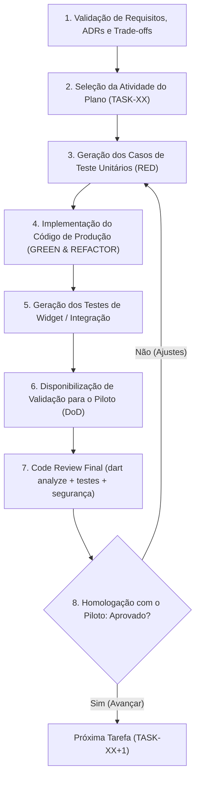
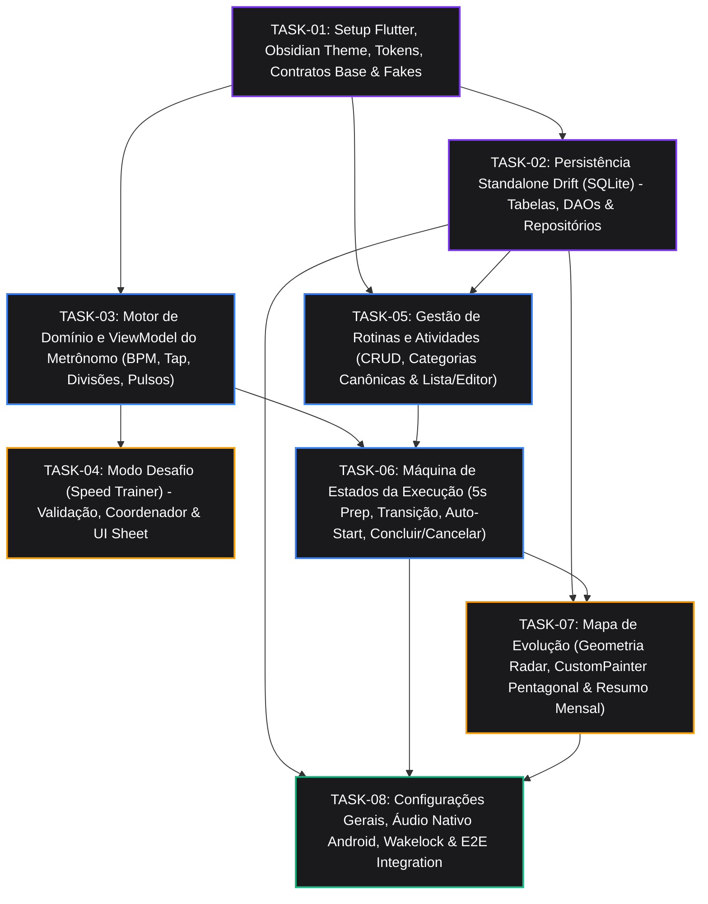

# Beatly — Mapa de Implementação Incremental (IMPLEMENTATION_MAP.md)

| Metadado | Detalhe |
| :--- | :--- |
| **Projeto** | Beatly — Assistente Inteligente e Metrônomo de Estudos Musicais |
| **Documento** | Plano e Mapa de Implementação Incremental Orientado a TDD |
| **Etapa do Projeto** | Etapa 3 — Refinamento da Implementação |
| **Versão** | 1.0.0 |
| **Status** | Pronto para Execução do Piloto |
| **Documentos Base** | [SPEC.md](file:///home/souza/projects/beatly/SPEC.md) (v1.1.0) & [ADR.md](file:///home/souza/projects/beatly/ADR.md) (v1.0.0) |
| **Metodologia** | TDD Estrito (Red → Green → Refactor) com Pirâmide de Testes |
| **Plataforma** | Flutter / Android Standalone (100% Offline-First) |

---

## 1. Visão Geral e Princípios do Loop de Implementação

Este documento estabelece o roteiro de engenharia para o desenvolvimento do **Beatly**. O projeto é decomposto em **8 tarefas incrementais e atômicas** (`TASK-01` a `TASK-08`), organizadas em ordem de dependência lógica e projetadas para serem executadas **uma tarefa por ciclo**.

Cada tarefa segue rigorosamente o **Loop de Implementação** auditado e homologado pelo **Piloto** conforme estabelecido no documento mestre do projeto (`beatly.md`):



### 1.1. Regras do Loop de Implementação (TDD)
1. **Fase RED (Obrigatória)**: Antes de qualquer linha de implementação de tela ou funcionalidade em `lib/`, os arquivos de teste unitário em `test/unit/` devem ser escritos e executados, falhando comprovadamente pelo motivo correto (compilação inicial ou asserção não atendida).
2. **Fase GREEN**: Escrever a quantidade estritamente necessária de código de produção para fazer todos os testes unitários passarem (`flutter test`).
3. **Fase REFACTOR**: Limpar duplicações, aplicar padrões limpos do Dart 3 (pattern matching, sealed classes, imutabilidade), sem quebrar nenhum teste existente.
4. **Fase WIDGET / INTEGRAÇÃO**: Escrever testes de componentes (`WidgetTester`) e fluxo com `ValueKey`s padronizados, garantindo que a UI reflete fielmente o estado do ViewModel e da máquina de estados.
5. **Critério de Inspeção Contínua**: Toda tarefa só é apresentada ao Piloto com `dart analyze` sem warnings/errors e 100% dos testes executados com sucesso.
6. **Fakes em Memória**: Nenhuma chamada de hardware (áudio nativo, relógio de SO, banco de dados em disco) é acoplada ao domínio ou aos testes de unidade; todas usam os contratos de porta (`ClockPort`, `MetronomeAudioPort`) com suas implementações em memória (`FakeClockPort`, `FakeMetronomeAudioPort`, `NativeDatabase.memory()`).

### 1.2. Matriz de Alocação de Modelos por Etapa do Loop TDD (Economia de Tokens vs. Qualidade)

Para reduzir drasticamente o consumo de tokens na conversa principal sem comprometer o rigor arquitetural, as etapas operacionais e de auditoria de cada ciclo são delegadas a subagentes isolados com o modelo ideal para cada função:

| Etapa do Loop TDD | Subagente Responsável | Modelo Selecionado | Justificativa de Custo x Qualidade |
| :--- | :--- | :--- | :--- |
| **Passo 3 (Fase RED: Escrita de Testes Unitários)** | `tdd-builder` | **`flash_lite`** ou **`flash`** | Escrita mecânica e estruturada de casos de teste já especificados no mapa (`TC-XX.YY`). |
| **Passo 4 (Fase GREEN: Implementação Operacional / UI / ViewModels)** | `tdd-builder` | **`flash`** | Alta velocidade e excelente custo-benefício para implementar código seguindo contratos claros (`ADR.md`), sem inflar o contexto principal. |
| **Passo 5 (Testes de Widget e Integração)** | `tdd-builder` | **`flash_lite`** ou **`flash`** | Geração de harnesses de widget (`WidgetTester`) com `ValueKey`s padronizados (`WTC-XX.YY`). |
| **Passos 6 e 7 (Validação de Testes, `dart analyze` & Code Review Sênior)** | `senior-code-reviewer` | **`pro`** | Raciocínio profundo para auditar máquinas de estado, trigonometria, casos de borda (`EC-01`..`EC-08`), isolamento de camadas e aprovação final dos testes. |
| **Passo 8 (Coordenação e Homologação com o Piloto)** | Agente Principal | — | Mantém o contexto enxuto, registra no `HISTORY.md` e apresenta o resumo executivo ao Piloto. |

---

## 2. Diagrama de Dependências entre as Tarefas



---

## 3. Matriz Geral de Rastreabilidade

| Tarefa | Nome da Tarefa | Requisitos Atendidos | ADRs Atendidos | Casos de Borda |
| :--- | :--- | :--- | :--- | :--- |
| **TASK-01** | Setup, Tema Obsidian Dark, Contratos Base e Fakes | `RNF-01`, `RNF-03`, `RNF-04`, `RNF-07` | `ADR-001`, `ADR-002`, `ADR-003`, `ADR-007`, `ADR-008` | - |
| **TASK-02** | Persistência Local com Drift (SQLite) Standalone | `RNF-01`, `RF-05`, `RF-06`, `RF-09`, `RF-10` | `ADR-004`, `ADR-007` | `EC-06` |
| **TASK-03** | Motor de Domínio e ViewModel do Metrônomo | `RF-01`, `RF-02`, `RF-03`, `RNF-02` | `ADR-001`, `ADR-002`, `ADR-007` | - |
| **TASK-04** | Modo Desafio (Speed Trainer) e Interface | `RF-04` | `ADR-001`, `ADR-002`, `ADR-003` | `EC-01`, `EC-02` |
| **TASK-05** | Gestão de Rotinas e Atividades (CRUD) | `RF-05`, `RF-06` | `ADR-001`, `ADR-004`, `ADR-008` | `EC-03`, `EC-04` |
| **TASK-06** | Máquina de Estados de Execução de Rotina e Tela de Foco | `RF-07`, `RF-08` | `ADR-001`, `ADR-002`, `ADR-003`, `ADR-006` | `EC-03`, `EC-04`, `EC-06` |
| **TASK-07** | Mapa de Evolução (Radar Chart & Resumo Mensal) | `RF-09`, `RF-10` | `ADR-001`, `ADR-004`, `ADR-005`, `ADR-008` | - |
| **TASK-08** | Configurações, Áudio Nativo Android, Wakelock & E2E | `RF-11`, `RF-12`, `RNF-02`, `RNF-05`, `RNF-06` | `ADR-002`, `ADR-006`, `ADR-007` | `EC-05`, `EC-07`, `EC-08` |

---

## 4. Detalhamento Incremental das Tarefas

---

### TASK-01: Setup do Projeto Flutter, Design System Obsidian Dark, Contratos Base e Fakes

#### 1. Objetivo e Escopo Incremental
Inicializar o projeto Flutter nativo para Android Standalone, estabelecendo a infraestrutura do projeto, as diretrizes de tipografia e paleta minimalista *Obsidian Dark* (`#0F0F10`, `#1A1A1C`, `#7C3AED`, `#F59E0B`), as portas abstratas fundamentais (`ClockPort`, `MetronomeAudioPort`), os modelos e enums de domínio essenciais e os Fakes em memória compartilhados que darão suporte a todas as fases de TDD do projeto.

#### 2. Requisitos e ADRs Atendidos
- **Requisitos**: `RNF-01` (Standalone), `RNF-03` (Android Nativo), `RNF-04` (UX Obsidian Dark), `RNF-07` (Testabilidade).
- **ADRs**: `ADR-001` (Arquitetura e DI), `ADR-002` (Contrato de Áudio), `ADR-003` (Contrato de Tempo Monotônico), `ADR-007` (Pirâmide de Testes), `ADR-008` (Design System Obsidian Dark).

#### 3. Arquivos a Criar / Modificar

**Produção (`lib/`):**
- `pubspec.yaml`: Dependências base (`drift`, `sqlite3_flutter_libs`, `path_provider`, `wakelock_plus`, `flutter_localizations`), dev_dependencies (`drift_dev`, `build_runner`, `flutter_test`, `test`, `checks`, `integration_test`).
- `lib/domain/contracts/clock_port.dart`: Interface para obter `now()`, `elapsedMilliseconds()` e stream `periodicTicks({required Duration interval})`.
- `lib/domain/contracts/metronome_audio_port.dart`: Interface com `initialize()`, `start()`, `updateBpm()`, `updatePattern()`, `stop()`, `playTransitionChime()`, `dispose()`.
- `lib/domain/models/beat_emphasis.dart`: Enum com os 4 estados de pulso: `forte` (100%), `normal` (70%), `fraco` (40%), `mudo` (0%).
- `lib/domain/models/activity_category.dart`: Enum canônico das 5 categorias: `tecnica`, `velocidade`, `teoriaMusical`, `improviso`, `freeStyle`.
- `lib/ui/core/constants/app_colors.dart`: Paleta Obsidian Deep Dark (`bg = 0xFF0F0F10`, `surface = 0xFF1A1A1C`, `elevated = 0xFF242426`, `border = 0xFF2E2E32`, `violet = 0xFF7C3AED`, `amber = 0xFFF59E0B`, `success = 0xFF10B981`, `error = 0xFFEF4444`, cores fixas das 5 categorias).
- `lib/ui/core/constants/app_dimensions.dart`: Padding e raios (`xs: 4`, `sm: 8`, `md: 16`, `lg: 24`, `cardRadius: 12`, `buttonRadius: 8`).
- `lib/ui/core/constants/app_typography.dart`: Família monoespaçada de alto contraste para numerais e cronômetros, sem-serifa limpa para rótulos.
- `lib/ui/core/theme/obsidian_theme.dart`: ThemeData escuro completo configurando Scaffold, Cards, Botões e AppBar.
- `lib/ui/core/widgets/obsidian_button.dart`: Botão customizado com suporte a variantes primária, perigo e outline.
- `lib/ui/core/widgets/obsidian_card.dart`: Container fosco padrão com borda sutil.
- `lib/ui/core/widgets/app_scaffold.dart`: Estrutura padrão com fundo `#0F0F10`.
- `lib/app.dart`: MaterialApp configurado com tema Obsidian.

**Testes e Fakes (`test/`):**
- `test/fakes/fake_clock_port.dart`: Fake de relógio que implementa `ClockPort`, permite controle manual de tempo via `advance(Duration duration)`, sem esperas reais de CPU.
- `test/fakes/fake_metronome_audio_port.dart`: Fake de áudio que registra chamadas (`isPlaying`, `currentBpm`, `activePattern`, `playedChimesCount`), sem emitir som físico.
- `test/unit/fakes/fake_clock_port_test.dart`: Teste unitário comprovando funcionamento determinístico do `FakeClockPort`.
- `test/unit/fakes/fake_metronome_audio_port_test.dart`: Teste unitário comprovando registro de chamadas do `FakeMetronomeAudioPort`.
- `test/widget/core/obsidian_theme_test.dart`: Validação de renderização de tokens do tema.
- `test/widget/core/obsidian_button_test.dart`: Teste de interação e estado do botão customizado.

#### 4. Casos de Teste Unitários (Fase RED do TDD)
- **`fake_clock_port_test.dart`**:
  - `TC-01.01`: Deve retornar tempo inicial configurado e avançar milissegundos exatamente na quantidade invocada por `advance()`.
  - `TC-01.02`: Deve emitir ticks no stream `periodicTicks` quando o tempo avançar além do intervalo configurado, emitindo a contagem correta.
  - `TC-01.03`: Não deve emitir ticks se o tempo avançado for inferior ao intervalo configurado.
- **`fake_metronome_audio_port_test.dart`**:
  - `TC-01.04`: Deve inicializar em estado parado (`isPlaying == false`) e sem BPM configurado.
  - `TC-01.05`: Ao chamar `start(bpm: 120, pattern: [...])`, deve registrar `isPlaying == true`, `currentBpm == 120` e o padrão ativo.
  - `TC-01.06`: Ao chamar `stop()`, deve redefinir `isPlaying == false`.
  - `TC-01.07`: Ao chamar `playTransitionChime()`, deve incrementar o contador histórico de chimes tocados.

#### 5. Casos de Teste de Widget
- **`obsidian_button_test.dart`**:
  - `WTC-01.01`: Deve renderizar com cor de fundo roxa (`AppColors.violet`) para variante primária e disparar callback ao ser clicado (`find.byKey(ValueKey('obsidian_button'))`).
  - `WTC-01.02`: Deve respeitar estado desabilitado (`onPressed == null`), apresentando opacidade reduzida e não disparando ações ao toque.

#### 6. Critério de Validação Prática pelo Piloto (DoD)
- Executar `flutter test test/unit/fakes/` com sucesso (100% passing em < 500ms).
- Executar `flutter test test/widget/core/` com sucesso.
- Executar `dart analyze` garantindo 0 erros e 0 warnings.
- Piloto visualiza que a base arquitetural e tokens Obsidian estão estabilizados e prontos para acoplamento das regras de persistência.

---

### TASK-02: Camada de Persistência Local Standalone com Drift (SQLite)

#### 1. Objetivo e Escopo Incremental
Implementar toda a camada de persistência local 100% offline-first com Drift (SQLite). Criar as 5 tabelas relacionais (`routines`, `routine_activities`, `study_sessions`, `session_category_logs`, `app_settings`), DAOs tipados, mappers bidirecionais e os três repositórios centrais (`DriftRoutineRepository`, `DriftSessionRepository`, `DriftSettingsRepository`), garantindo testes unitários e de integração de persistência ultrarrápidos utilizando `NativeDatabase.memory()`.

#### 2. Requisitos e ADRs Atendidos
- **Requisitos**: `RNF-01` (Standalone / Offline), `RF-05` (Persistência de Rotinas), `RF-06` (Persistência de Atividades com ordenação), `RF-09` (Logs por Categoria da Sessão), `RF-10` (Agregação Histórica Mensal).
- **ADRs**: `ADR-004` (Drift SQLite Standalone com FKs e memória para TDD), `ADR-007` (Testes de Repositório).
- **Casos de Borda**: `EC-06` (Salvamento condicional de progresso parcial vs descarte).

#### 3. Arquivos a Criar / Modificar

**Produção (`lib/`):**
- `lib/data/datasources/local/tables/routines_table.dart`: Tabela com `id` (Text/UUID), `name`, `colorHex`, `createdAt`, `updatedAt`.
- `lib/data/datasources/local/tables/routine_activities_table.dart`: Tabela com `id`, `routineId` (FK CASCADE), `name`, `category`, `durationSeconds`, `bpm` (nullable), `autoStartMetronome` (boolean), `notes`, `orderIndex`.
- `lib/data/datasources/local/tables/study_sessions_table.dart`: Tabela com `id`, `routineId` (FK SET NULL), `routineNameSnapshot`, `startedAt`, `endedAt`, `totalDurationSeconds`, `isCompletedEarly`.
- `lib/data/datasources/local/tables/session_category_logs_table.dart`: Tabela com `id`, `sessionId` (FK CASCADE), `category`, `durationSeconds`.
- `lib/data/datasources/local/tables/app_settings_table.dart`: Tabela de chave-valor `key` (PK), `valueJson`.
- `lib/data/datasources/local/app_database.dart`: Definição central `@DriftDatabase` contendo as tabelas e DAOs.
- `lib/data/datasources/local/daos/routine_dao.dart`: CRUD de rotinas e atividades com transações atômicas e ordenação por `orderIndex`.
- `lib/data/datasources/local/daos/session_dao.dart`: Inserção de sessões com logs e queries agregadas mensais (`SUM(durationSeconds) GROUP BY category`).
- `lib/data/datasources/local/daos/settings_dao.dart`: Leitura e escrita de preferências locais.
- `lib/domain/contracts/routine_repository.dart`: Interface com `getAllRoutines()`, `getRoutineById()`, `saveRoutine()`, `deleteRoutine()`, `duplicateRoutine()`.
- `lib/domain/contracts/session_repository.dart`: Interface com `saveSession()`, `getSessionsByMonth()`, `getCategoryAggregatesByMonth()`.
- `lib/domain/contracts/settings_repository.dart`: Interface com `getTransitionCountdownSeconds()`, `saveTransitionCountdownSeconds()`, preferências de áudio/wakelock.
- `lib/data/mappers/routine_mapper.dart`: Converte Drift DataClasses em entidades imutáveis de domínio `Routine` e `RoutineActivity`.
- `lib/data/mappers/session_mapper.dart`: Converte sessões e logs.
- `lib/data/mappers/settings_mapper.dart`: Converte configurações.
- `lib/data/repositories/drift_routine_repository.dart`: Implementação concreta de `RoutineRepository`.
- `lib/data/repositories/drift_session_repository.dart`: Implementação concreta de `SessionRepository`.
- `lib/data/repositories/drift_settings_repository.dart`: Implementação concreta de `SettingsRepository`.

**Testes e Fakes (`test/`):**
- `test/fakes/in_memory_app_database.dart`: Constrói o `AppDatabase` usando `NativeDatabase.memory()`.
- `test/unit/data/daos/routine_dao_test.dart`: Teste unitário de operações relacionais de rotinas e atividades.
- `test/unit/data/daos/session_dao_test.dart`: Teste unitário de agregação de sessões e integridade referencial.
- `test/unit/data/repositories/drift_routine_repository_test.dart`: Teste unitário do repositório de rotinas.
- `test/unit/data/repositories/drift_session_repository_test.dart`: Teste unitário do repositório de sessões e relatório mensal.
- `test/unit/data/repositories/drift_settings_repository_test.dart`: Teste unitário do repositório de configurações.

#### 4. Casos de Teste Unitários (Fase RED do TDD)
- **`drift_routine_repository_test.dart`**:
  - `TC-02.01`: Deve salvar uma rotina completa com 3 atividades ordenadas e recuperá-la preservando exatamente os `orderIndex` (0, 1, 2).
  - `TC-02.02`: Ao atualizar uma rotina com remoção de uma atividade, a tabela de atividades deve sofrer deleção correspondente sem deixar orfãos.
  - `TC-02.03`: Ao excluir uma rotina via `deleteRoutine(id)`, todas as atividades atreladas devem ser deletadas em cascata (`CASCADE`).
  - `TC-02.04`: Ao duplicar uma rotina via `duplicateRoutine(id)`, deve criar uma cópia com novo ID, nome contendo sufixo " (Cópia)" e duplicar todas as atividades.
- **`drift_session_repository_test.dart`**:
  - `TC-02.05`: Deve salvar uma sessão de estudo com 3 logs de categorias diferentes de forma atômica em transação SQLite.
  - `TC-02.06`: Ao consultar agregações mensais via `getCategoryAggregatesByMonth(year, month)`, deve retornar a soma precisa em segundos agrupada por cada uma das categorias presentes naquele intervalo.
  - `TC-02.07`: Se uma rotina originária de uma sessão for apagada posteriormente, o registro da `study_sessions` deve permanecer íntegro com `routineId == null` e o `routineNameSnapshot` preservado.
- **`drift_settings_repository_test.dart`**:
  - `TC-02.08`: Deve retornar o valor padrão de 5 segundos para o contador de transição se nenhuma configuração anterior tiver sido gravada.
  - `TC-02.09`: Deve persistir novo valor de transição e recuperá-lo com exatidão.

#### 5. Critério de Validação Prática pelo Piloto (DoD)
- Executar `dart run build_runner build --delete-conflicting-outputs` gerando os arquivos Drift com sucesso.
- Executar `flutter test test/unit/data/` com 100% de aprovação em banco de dados SQLite em memória.
- Validar que a integridade referencial (`ON DELETE CASCADE`) e integridade histórica (`NULL ON DELETE`) funcionam estritamente como definido em `ADR-004`.

---

### TASK-03: Motor de Domínio e ViewModel do Metrônomo

#### 1. Objetivo e Escopo Incremental
Implementar o motor de domínio do metrônomo (BPM de 20 a 300, algoritmo de Tap Tempo com média móvel dos últimos 4 toques, fórmula de compasso de 1 a 16 batidas, subdivisões e 4 estados cíclicos de ênfase por pulso: Forte, Normal, Fraco, Mudo) e sua ViewModel reativa (`MetronomeViewModel`), integrando com o `MetronomeAudioPort` e construindo os componentes de UI correspondentes no tema Obsidian Dark.

#### 2. Requisitos e ADRs Atendidos
- **Requisitos**: `RF-01` (Controle de BPM e Tap Tempo), `RF-02` (Fórmula de Compasso e Subdivisão), `RF-03` (Controle Individual de Volume e Acentuação por Pulso com LEDs), `RNF-02` (Precisão de Áudio).
- **ADRs**: `ADR-001` (MVVM e ChangeNotifier), `ADR-002` (MetronomeAudioPort), `ADR-008` (Design System).

#### 3. Arquivos a Criar / Modificar

**Produção (`lib/`):**
- `lib/domain/use_cases/calculate_tap_tempo_use_case.dart`: Use Case puro em Dart que calcula BPM baseado em lista de timestamps dos últimos toques (média ponderada dos últimos 4 toques, rejeitando intervalos fora de 200ms..3000ms).
- `lib/domain/models/metronome_config.dart`: Modelo imutável guardando BPM atual, numerador (batidas por compasso: 1 a 16), denominador, subdivisão e lista de `BeatEmphasis`.
- `lib/ui/features/metronome/view_models/metronome_view_model.dart`: ChangeNotifier com comandos `togglePlay()`, `setBpm(int)`, `incrementBpm(int)`, `decrementBpm(int)`, `registerTap()`, `cycleBeatEmphasis(int index)`, `setBeatsPerBar(int)`.
- `lib/ui/features/metronome/widgets/bpm_stepper.dart`: Componente com botões `-5`, `-1`, display monoespaçado de BPM, e botões `+1`, `+5`.
- `lib/ui/features/metronome/widgets/beat_strip_selector.dart`: Faixa horizontal interativa renderizando cada batida com seu estado de ênfase (Forte, Normal, Fraco, Mudo) e indicador luminoso LED sincronizado.
- `lib/ui/features/metronome/widgets/tap_tempo_button.dart`: Botão de interação tátil para cálculo de andamento por batidas.
- `lib/ui/core/widgets/pulse_led_indicator.dart`: Indicador visual luminoso circular estilo LED para pulsos rítmicos.
- `lib/ui/features/metronome/views/metronome_screen.dart`: Tela principal do Metrônomo minimalista Obsidian Dark.

**Testes (`test/`):**
- `test/unit/domain/use_cases/calculate_tap_tempo_use_case_test.dart`: Teste unitário matemático de cálculo de Tap Tempo.
- `test/unit/ui/view_models/metronome_view_model_test.dart`: Teste unitário do ViewModel injetando `FakeMetronomeAudioPort` e `FakeClockPort`.
- `test/widget/metronome/bpm_stepper_test.dart`: Teste de widget de botões e display de BPM.
- `test/widget/metronome/beat_strip_selector_test.dart`: Teste de widget de clique cíclico nos estados de pulso.
- `test/widget/metronome/tap_tempo_button_test.dart`: Teste de widget de múltiplos toques sucessivos.
- `test/widget/metronome/metronome_screen_test.dart`: Teste de widget da tela completa do metrônomo.

#### 4. Casos de Teste Unitários (Fase RED do TDD)
- **`calculate_tap_tempo_use_case_test.dart`**:
  - `TC-03.01`: Deve retornar nulo se houver menos de 2 toques válidos registrados.
  - `TC-03.02`: Com 4 toques com espaçamento constante de 500ms, deve calcular exatamente 120 BPM (`[B-RF-01.3]`).
  - `TC-03.03`: Com toques espaçados em 1000ms, deve calcular 60 BPM.
  - `TC-03.04`: Toques com intervalos maiores que 3000ms ou menores que 200ms devem reiniciar a contagem.
- **`metronome_view_model_test.dart`**:
  - `TC-03.05`: Inicialização padrão: 120 BPM, compasso 4/4, padrão inicial `[Forte, Normal, Normal, Normal]`.
  - `TC-03.06`: `incrementBpm(5)` deve elevar de 120 para 125 e repassar novo BPM para `audioPort.updateBpm(125)` (`[B-RF-01.1]`).
  - `TC-03.07`: `incrementBpm(5)` em 298 BPM deve travar rigorosamente em 300 BPM e desativar futuros incrementos (`[B-RF-01.2]`).
  - `TC-03.08`: `decrementBpm(5)` em 22 BPM deve travar rigorosamente no piso de 20 BPM.
  - `TC-03.09`: `cycleBeatEmphasis(1)` na batida 2 (estado inicial `Normal`) deve transitar para `Fraco`, e nova invocação transita para `Mudo`, e depois para `Forte` (`[B-RF-03.1]`).
  - `TC-03.10`: `togglePlay()` deve acionar `audioPort.start()` quando ocioso e `audioPort.stop()` quando em execução.

#### 5. Casos de Teste de Widget (com `ValueKey`s padronizados)
- **`metronome_screen_test.dart`**:
  - `WTC-03.01`: Clicar no botão `ValueKey('metronome_btn_play_pause')` alterna o ícone entre play e pause e atualiza o ViewModel.
  - `WTC-03.02`: Clicar no botão `ValueKey('metronome_bpm_plus_1')` atualiza o texto `ValueKey('metronome_bpm_text')` em +1.
  - `WTC-03.03`: Clicar na batida `ValueKey('beat_emphasis_item_1')` altera o ícone e cor do indicador de pulso cíclico.
  - `WTC-03.04`: Tocar 4 vezes seguidas em `ValueKey('metronome_btn_tap_tempo')` com 500ms atualiza o display de BPM para 120.

#### 6. Critério de Validação Prática pelo Piloto (DoD)
- Executar `flutter test test/unit/domain/use_cases/calculate_tap_tempo_use_case_test.dart`.
- Executar `flutter test test/unit/ui/view_models/metronome_view_model_test.dart`.
- Executar `flutter test test/widget/metronome/`.
- Piloto valida interativamente que a tela do metrônomo responde aos toques de BPM, exibe os 4 estados visuais de pulso e calcula o Tap Tempo de forma fidedigna.

---

### TASK-04: Modo Desafio (Speed Trainer) no Metrônomo

#### 1. Objetivo e Escopo Incremental
Implementar o Modo Desafio (Speed Trainer progressivo), permitindo que o estudante configure aceleração gradual por compassos ou tempo ($BPM_{min}$, $BPM_{max}$, incremento $\Delta BPM$). Construir a máquina de estados `SpeedChallengeCoordinator`, o Use Case de validação estrita de limites, a ViewModel e o painel visual (Bottom Sheet) no tema Obsidian Dark com velocímetro e contador dinâmico.

#### 2. Requisitos e ADRs Atendidos
- **Requisitos**: `RF-04` (Speed Trainer Progressivo com incremento por compasso ou tempo, opções no teto: Manter ou Concluir).
- **ADRs**: `ADR-001` (ViewModel), `ADR-002` (MetronomeAudioPort), `ADR-003` (ClockPort Monotônico).
- **Casos de Borda**: `EC-01` ($BPM_{min} \ge BPM_{max}$ bloqueia início), `EC-02` (Incremento não múltiplo ajusta exatamente no teto).

#### 3. Arquivos a Criar / Modificar

**Produção (`lib/`):**
- `lib/domain/models/speed_challenge_config.dart`: Modelo imutável guardando `startBpm`, `targetBpm`, `bpmStep`, `stepTrigger` (`byBars(int)` ou `byDuration(Duration)`), e `onTargetReached` (`keepRunning` ou `stopAndChime`).
- `lib/domain/use_cases/validate_speed_challenge_use_case.dart`: Valida $BPM_{min} < BPM_{max}$, $\Delta BPM > 0$ e $\Delta BPM \le (BPM_{max} - BPM_{min})$.
- `lib/domain/state_machines/speed_challenge_coordinator.dart`: Coordena a progressão de andamento do metrônomo, escutando compassos completados ou ticks temporais de `ClockPort`, recalculando e aplicando o novo BPM em tempo real no `MetronomeAudioPort`.
- `lib/ui/features/metronome/view_models/speed_challenge_view_model.dart`: Gerencia o formulário de configuração do desafio, progresso percentual até a meta e estado de execução.
- `lib/ui/features/metronome/views/speed_challenge_bottom_sheet.dart`: Painel inferior modal com controles numéricos, seleção de critério e barra de progresso Obsidian.

**Testes (`test/`):**
- `test/unit/domain/use_cases/validate_speed_challenge_use_case_test.dart`: Teste unitário de validação de parâmetros do desafio.
- `test/unit/domain/state_machines/speed_challenge_coordinator_test.dart`: Teste unitário da progressão rítmica com Fakes.
- `test/unit/ui/view_models/speed_challenge_view_model_test.dart`: Teste unitário do ViewModel do desafio.
- `test/widget/metronome/speed_challenge_bottom_sheet_test.dart`: Teste de widget dos campos de entrada, validação de erro e progresso.

#### 4. Casos de Teste Unitários (Fase RED do TDD)
- **`validate_speed_challenge_use_case_test.dart`**:
  - `TC-04.01`: Deve retornar erro de validação se $BPM_{min} \ge BPM_{max}$ (`[B-RF-04.2]`, `EC-01`).
  - `TC-04.02`: Deve retornar erro se $\Delta BPM \le 0$ ou se $\Delta BPM > (BPM_{max} - BPM_{min})$.
  - `TC-04.03`: Deve validar com sucesso parâmetros consistentes (ex.: min 100, max 140, step 5).
- **`speed_challenge_coordinator_test.dart`**:
  - `TC-04.04`: Desafio por compassos: com $BPM_{min} = 100$, step de 5 a cada 4 compassos, ao completar o 4º compasso deve atualizar `audioPort.updateBpm(105)` (`[B-RF-04.1]`).
  - `TC-04.05`: Ajuste fino no teto (`EC-02`): Atual 115, $\Delta BPM = 10$, Max 120. Ao disparar incremento, o novo BPM deve ser fixado exatamente em 120 (e não 125).
  - `TC-04.06`: Opção `stopAndChime` no teto: ao atingir o $BPM_{max}$ e completar o compasso final, deve chamar `audioPort.playTransitionChime()` e `audioPort.stop()`.
  - `TC-04.07`: Opção `keepRunning` no teto: ao atingir o $BPM_{max}$, deve manter o metrônomo tocando sem interrupção.

#### 5. Casos de Teste de Widget (com `ValueKey`s padronizados)
- **`speed_challenge_bottom_sheet_test.dart`**:
  - `WTC-04.01`: Ao digitar $BPM_{min} = 150$ e $BPM_{max} = 120$, o botão `ValueKey('challenge_btn_start')` fica desabilitado e a mensagem de erro `ValueKey('challenge_error_text')` fica visível (`EC-01`).
  - `WTC-04.02`: Com campos válidos, clicar em `ValueKey('challenge_btn_start')` inicia o desafio e exibe o velocímetro dinâmico `ValueKey('challenge_progress_bar')`.

#### 6. Critério de Validação Prática pelo Piloto (DoD)
- Executar `flutter test test/unit/domain/state_machines/speed_challenge_coordinator_test.dart`.
- Executar `flutter test test/widget/metronome/speed_challenge_bottom_sheet_test.dart`.
- Piloto simula a configuração de um desafio e comprova visualmente a rejeição de limites inválidos e a aceleração programada.

---

### TASK-05: Gestão de Rotinas e Atividades (CRUD)

#### 1. Objetivo e Escopo Incremental
Implementar o módulo completo de criação, visualização, edição, duplicação e remoção de Rotinas e Atividades de estudo. Aplicar a lista fechada e canônica das 5 categorias (`Técnica`, `Velocidade`, `Teoria Musical`, `Improviso`, `Free Style`), o cálculo dinâmico da duração total da rotina ($\sum \text{atividades} + \sum \text{transições}$), a dependência obrigatória de BPM para a flag `autoStartMetronome`, a reordenação de atividades e as telas de interface (listagem e formulário com design Obsidian).

#### 2. Requisitos e ADRs Atendidos
- **Requisitos**: `RF-05` (Gestão de Rotinas com UUID, nome, cor, cálculo de duração e duplicação), `RF-06` (Atividades com classificação canônica, duração, BPM opcional e regra de auto-start).
- **ADRs**: `ADR-001` (Arquitetura e Repositórios), `ADR-004` (Drift SQLite), `ADR-008` (Obsidian Theme).
- **Casos de Borda**: `EC-03` (autoStart desativado se BPM nulo), `EC-04` (Rotina de 1 atividade sem transição).

#### 3. Arquivos a Criar / Modificar

**Produção (`lib/`):**
- `lib/domain/models/routine.dart`: Entidade rica imutável contendo cálculo de `totalDuration(int transitionSeconds)` e método `copyWith`.
- `lib/domain/models/routine_activity.dart`: Entidade com validações (`name.length in 1..80`, duração $\ge 10s$).
- `lib/ui/features/routine_management/view_models/routine_list_view_model.dart`: Carrega rotinas do repositório, suporta busca, exclusão e duplicação rápida.
- `lib/ui/features/routine_management/view_models/routine_editor_view_model.dart`: Formulário de criação/edição com reordenação de atividades, validações em tempo real e auto-desativação de `autoStartMetronome` caso BPM seja removido.
- `lib/ui/features/routine_management/widgets/category_picker.dart`: Seletor com exclusivamente as 5 categorias canônicas estilizadas com suas respectivas cores.
- `lib/ui/features/routine_management/widgets/activity_list_tile.dart`: Card de atividade com alça de reordenação (`ReorderableListView`), tempo, badge da categoria e indicador de auto-start.
- `lib/ui/features/routine_management/views/routine_list_screen.dart`: Tela inicial da pasta de estudos com lista de rotinas e botão de criação rápida.
- `lib/ui/features/routine_management/views/routine_editor_screen.dart`: Tela completa de edição de rotina e atividades.

**Testes (`test/`):**
- `test/unit/domain/models/routine_test.dart`: Teste unitário de cálculo da duração total da rotina.
- `test/unit/ui/view_models/routine_list_view_model_test.dart`: Teste unitário do ViewModel da lista com repositório em memória.
- `test/unit/ui/view_models/routine_editor_view_model_test.dart`: Teste unitário do editor, reordenação e regras de BPM.
- `test/widget/routine_management/category_picker_test.dart`: Teste de widget do seletor das 5 categorias canônicas.
- `test/widget/routine_management/routine_editor_screen_test.dart`: Teste de formulário, validação de campos e criação de atividades.
- `test/widget/routine_management/routine_list_screen_test.dart`: Teste de listagem, duplicação e exclusão.

#### 4. Casos de Teste Unitários (Fase RED do TDD)
- **`routine_test.dart`**:
  - `TC-05.01`: Rotina com 3 atividades (10m, 15m, 5m) e transição de 5s (2 intervalos = 10s) deve calcular duração total de 30 minutos e 10 segundos (`[B-RF-05.1]`).
  - `TC-05.02`: Rotina com 1 atividade (10m) deve calcular duração total de 10m sem tempo de transição adicional (`EC-04`).
- **`routine_editor_view_model_test.dart`**:
  - `TC-05.03`: As categorias selecionáveis devem conter única e exclusivamente as 5 categorias canônicas (`[B-RF-06.1]`).
  - `TC-05.04`: Ao tentar ativar `autoStartMetronome = true` em uma atividade sem BPM, o ViewModel deve rejeitar ou fixar em `false` (`[B-RF-06.2]`, `EC-03`).
  - `TC-05.05`: Se uma atividade tinha BPM 120 e `autoStartMetronome = true`, ao limpar o BPM, `autoStartMetronome` deve mudar automaticamente para `false`.
  - `TC-05.06`: Reordenar atividades via `reorderActivity(oldIndex, newIndex)` deve atualizar a lista preservando a nova sequência ordinal.
- **`routine_list_view_model_test.dart`**:
  - `TC-05.07`: `duplicateRoutine(id)` deve chamar o repositório e recarregar a lista exibindo a nova rotina duplicada.

#### 5. Casos de Teste de Widget (com `ValueKey`s padronizados)
- **`routine_editor_screen_test.dart`**:
  - `WTC-05.01`: Verificar que o seletor `ValueKey('category_picker')` renderiza exatamente 5 opções com os rótulos: "Técnica", "Velocidade", "Teoria Musical", "Improviso", "Free Style".
  - `WTC-05.02`: Switch `ValueKey('activity_switch_autostart')` permanece desabilitado enquanto o campo `ValueKey('activity_input_bpm')` estiver vazio.
  - `WTC-05.03`: Preencher nome da rotina `ValueKey('routine_input_name')`, adicionar 2 atividades e tocar em `ValueKey('routine_btn_save')` salva com sucesso e retorna à lista.

#### 6. Critério de Validação Prática pelo Piloto (DoD)
- Executar `flutter test test/unit/ui/view_models/routine_editor_view_model_test.dart`.
- Executar `flutter test test/widget/routine_management/`.
- Piloto cria uma rotina de teste com 3 atividades, reordena arrastando os itens, altera categorias e confere que a duração total estimada é calculada instantaneamente.

---

### TASK-06: Máquina de Estados da Execução de Rotina e Tela de Foco

#### 1. Objetivo e Escopo Incremental
Implementar o núcleo da experiência de treino: o orquestrador finíto determinístico `RoutineExecutionCoordinator` e a Tela de Foco do Estudo (`RoutineExecutionScreen`). Implementar a contagem de preparação inicial (5s), transições entre atividades com aviso sonoro suave (`playTransitionChime`) e contagem regressiva (default 5s) com botão "Iniciar Agora", auto-start de metrônomo sincronizado, **Conclusão Automática** ao zerar a última atividade, ação manual **Concluir** (salva progresso parcial praticado e abre resultados) e ação manual **Cancelar** (aborta imediatamente e descarta/ignora todo o progresso).

#### 2. Requisitos e ADRs Atendidos
- **Requisitos**: `RF-07` (Execução isolada, controles de foco, auto-conclusão, Concluir vs Cancelar), `RF-08` (Transição suave, chime zen, contagem regressiva e atalho Iniciar Agora).
- **ADRs**: `ADR-001` (ViewModel), `ADR-002` (Áudio e Chime), `ADR-003` (Máquina de Estados e Relógio Monotônico), `ADR-006` (Wakelock).
- **Casos de Borda**: `EC-03` (BPM ausente inicia em silêncio), `EC-04` (Rotina com 1 atividade), `EC-06` (Concluir vs Cancelar).

#### 3. Arquivos a Criar / Modificar

**Produção (`lib/`):**
- `lib/domain/models/routine_execution_state.dart`: Sealed class com os estados:
  - `ExecutionStateIdle`
  - `ExecutionStatePreparing(int remainingSeconds)`
  - `ExecutionStateRunning(RoutineActivity currentActivity, Duration remainingDuration, bool isMetronomeActive)`
  - `ExecutionStatePaused(RoutineActivity currentActivity, Duration remainingDuration)`
  - `ExecutionStateTransitioning(RoutineActivity nextActivity, int remainingSeconds)`
  - `ExecutionStateCompleted(StudySession session, Map<PracticeCategory, Duration> results)`
  - `ExecutionStateCanceled`
- `lib/domain/state_machines/routine_execution_coordinator.dart`: Máquina de estados desacoplada que consome `ClockPort`, `MetronomeAudioPort`, `SessionRepository` e dispara transições sem acoplamento a widgets Flutter.
- `lib/ui/features/routine_execution/view_models/routine_execution_view_model.dart`: ViewModel com comandos: `startRoutine()`, `pause()`, `resume()`, `skipToNext()`, `previous()`, `skipTransition()`, `completeRoutineEarly()`, `cancelRoutine()`.
- `lib/ui/features/routine_execution/widgets/preparation_overlay.dart`: Contagem regressiva grande e imersiva de preparação inicial (05s).
- `lib/ui/features/routine_execution/widgets/transition_countdown_overlay.dart`: Tela de transição entre exercícios com botão "Iniciar Agora".
- `lib/ui/features/routine_execution/widgets/execution_controls_bar.dart`: Barra de comandos com botões de Pausar/Retomar, Pular, **Concluir** e **Cancelar**.
- `lib/ui/features/routine_execution/views/routine_execution_screen.dart`: Tela completa de imersão de estudo em tema Obsidian Dark.

**Testes (`test/`):**
- `test/unit/domain/state_machines/routine_execution_coordinator_test.dart`: Teste unitário exaustivo da máquina de estados com `FakeClockPort` e `FakeMetronomeAudioPort`.
- `test/unit/ui/view_models/routine_execution_view_model_test.dart`: Teste unitário de interação e dispatch de comandos do ViewModel.
- `test/widget/routine_execution/preparation_countdown_test.dart`: Teste de widget da contagem inicial de preparação.
- `test/widget/routine_execution/transition_screen_test.dart`: Teste de widget da transição e botão "Iniciar Agora".
- `test/widget/routine_execution/routine_execution_screen_test.dart`: Teste de widget da tela de foco completa.

#### 4. Casos de Teste Unitários (Fase RED do TDD)
- **`routine_execution_coordinator_test.dart`**:
  - `TC-06.01`: Ao chamar `start()`, transita imediatamente para `Preparing` com 5 segundos restantes.
  - `TC-06.02`: Ao avançar 5 segundos no `fakeClock`, transita automaticamente de `Preparing` para `Running` da Atividade 1. Se `autoStartMetronome == true` e `bpm != null`, aciona `audioPort.start()` (`[B-RF-07.1]`).
  - `TC-06.03`: Ao esgotar o tempo da Atividade 1, deve parar o metrônomo (`audioPort.stop()`), tocar o aviso suave (`audioPort.playTransitionChime()`) e transitar para `Transitioning` com 5 segundos restantes (`[B-RF-08.1]`).
  - `TC-06.04`: Durante o estado `Transitioning`, invocar `skipTransition()` encerra a contagem imediatamente e transita para `Running` da próxima atividade (`[B-RF-08.2]`).
  - `TC-06.05`: **Conclusão Automática**: Ao zerar o cronômetro da última atividade, transita automaticamente para `Completed`, grava a sessão completa no `SessionRepository` e desliga o áudio (`[B-RF-07.2]`).
  - `TC-06.06`: **Conclusão Manual Antecipada ("Concluir")**: Estando na 2ª atividade de uma rotina de 4, acionar `completeEarly()` deve transitar imediatamente para `Completed`, computar apenas os segundos efetivamente estudados e persistir a sessão com a flag `isCompletedEarly = true` (`[B-RF-07.3]`, `EC-06`).
  - `TC-06.07`: **Cancelamento com Descarte ("Cancelar")**: Com 15 minutos já decorridos, acionar `cancel()` deve transitar para `Canceled`, parar o som e **não salvar nenhum registro no SessionRepository** (descarte total) (`[B-RF-07.4]`, `EC-06`).
  - `TC-06.08`: Pausar e retomar congela e reativa os tempos de forma isócrona sem perder milissegundos acumulados.

#### 5. Casos de Teste de Widget (com `ValueKey`s padronizados)
- **`routine_execution_screen_test.dart`**:
  - `WTC-06.01`: Durante preparação, widget `ValueKey('execution_prep_overlay')` exibe "Preparar" e contagem decrescente.
  - `WTC-06.02`: Durante transição, clicar em `ValueKey('transition_btn_skip_now')` fecha a transição instantaneamente e inicia a próxima atividade.
  - `WTC-06.03`: Clicar no botão `ValueKey('execution_btn_complete')` conclui antecipadamente e navega para o diálogo de resultados.
  - `WTC-06.04`: Clicar no botão `ValueKey('execution_btn_cancel')` abre confirmação e, ao confirmar em `ValueKey('dialog_btn_confirm_cancel')`, retorna à tela anterior sem persistência.

#### 6. Critério de Validação Prática pelo Piloto (DoD)
- Executar `flutter test test/unit/domain/state_machines/routine_execution_coordinator_test.dart` (100% passing).
- Executar `flutter test test/widget/routine_execution/`.
- Piloto valida o ciclo de execução: inicia a rotina, observa a preparação de 5s, o cronômetro da atividade correndo, o aviso sonoro e transição suave, testando tanto a conclusão manual quanto o cancelamento com descarte.

---

### TASK-07: Mapa de Evolução (Analytics Local & Radar Chart)

#### 1. Objetivo e Escopo Incremental
Implementar o Módulo de Analytics Local do Beatly: o Use Case trigonométrico puro `CalculateRadarGeometryUseCase` para projeção dos 5 eixos canônicos (`Técnica`, `Velocidade`, `Teoria Musical`, `Improviso`, `Free Style`), o Use Case de agregação analítica `CalculateMonthlySummaryUseCase`, o componente gráfico `RadarChartPainter` (subclasse nativa de `CustomPainter` minimalista estilo Obsidian Dark), a tela de resultados pós-rotina (`SessionCompletedDialog`) e a tela de Resumo Mensal com calendário de consistência (`MonthlyConsistencyCalendar`).

#### 2. Requisitos e ADRs Atendidos
- **Requisitos**: `RF-09` (Gráfico de Teia da Sessão, normalização dinâmica proporcional, destaque da categoria mais treinada e categorias zeradas), `RF-10` (Resumo Mensal consolidado, seletor de mês/ano, horas totais, média diária e mapa de consistência).
- **ADRs**: `ADR-001` (ViewModel), `ADR-004` (Drift SQLite Queries), `ADR-005` (Radar Chart Desacoplado via CustomPainter), `ADR-008` (Design System Obsidian Dark).

#### 3. Arquivos a Criar / Modificar

**Produção (`lib/`):**
- `lib/domain/models/radar_polygon_data.dart`: Modelo imutável guardando coordenadas cartesianas dos 5 eixos de grelha de fundo (25%, 50%, 75%, 100%) e pontos do polígono preenchido dos dados praticados.
- `lib/domain/models/practice_category_summary.dart`: DTO consolidando tempo, percentual e rótulo de destaque.
- `lib/domain/use_cases/calculate_radar_geometry_use_case.dart`: Use Case matemático puro (zero dependência de `dart:ui` ou Flutter widgets) que projeta ângulos $\theta_i = -\frac{\pi}{2} + i \cdot \frac{2\pi}{5}$ e calcula $P_i = (C_x + r_i\cos\theta, C_y + r_i\sin\theta)$.
- `lib/domain/use_cases/calculate_monthly_summary_use_case.dart`: Agrega sessões do mês calculando tempo total, média diária, distribuição percentual e dias ativos.
- `lib/ui/features/evolution_map/widgets/radar_chart_painter.dart`: `CustomPainter` de alta performance renderizando o pentágono e área preenchida com transparência roxa sobre `#1A1A1C`.
- `lib/ui/features/evolution_map/widgets/monthly_consistency_calendar.dart`: Mini-calendário de mapa de calor dos dias com prática musical realizada.
- `lib/ui/features/evolution_map/view_models/evolution_map_view_model.dart`: ViewModel gerenciando navegação de meses (anterior/próximo) e consultas analíticas no `SessionRepository`.
- `lib/ui/features/evolution_map/views/session_completed_dialog.dart`: Tela modal apresentada logo após conclusão de rotina exibindo o Gráfico de Teia e categoria mais treinada.
- `lib/ui/features/evolution_map/views/evolution_map_screen.dart`: Tela da aba "Mapa de Evolução" com histórico mensal completo.

**Testes (`test/`):**
- `test/unit/domain/use_cases/calculate_radar_geometry_use_case_test.dart`: Teste unitário trigonométrico de geometria dos vértices e normalização dinâmica.
- `test/unit/domain/use_cases/calculate_monthly_summary_use_case_test.dart`: Teste unitário de cálculos analíticos mensais.
- `test/unit/ui/view_models/evolution_map_view_model_test.dart`: Teste unitário do ViewModel de mapa de evolução.
- `test/widget/evolution_map/radar_chart_widget_test.dart`: Teste de widget de renderização do Radar Chart via `CustomPaint`.
- `test/widget/evolution_map/session_completed_dialog_test.dart`: Teste de widget do modal pós-rotina.
- `test/widget/evolution_map/evolution_map_screen_test.dart`: Teste de widget da tela mensal.

#### 4. Casos de Teste Unitários (Fase RED do TDD)
- **`calculate_radar_geometry_use_case_test.dart`**:
  - `TC-07.01`: O vértice 0 (`Técnica`) deve estar posicionado rigorosamente no topo vertical ($\theta = -\frac{\pi}{2}$ radianos / $-90^\circ$).
  - `TC-07.02`: Com tempos de sessão: Técnica 20m, Velocidade 15m, Teoria 10m, Improviso 0m, Free Style 0m, o valor máximo deve ser 20m, e a razão do raio de Técnica deve ser 1.0, Velocidade 0.75, Teoria 0.50 e os demais 0.0 (`[B-RF-09.1]`).
  - `TC-07.03`: Para sessão com 0 segundos em todas as categorias, o Use Case deve retornar coordenadas no centro $(C_x, C_y)$ sem lançar divisão por zero.
  - `TC-07.04`: As grelhas poligonais de fundo devem gerar exatamente 4 níveis concêntricos (25%, 50%, 75%, 100%) de 5 vértices cada.
- **`calculate_monthly_summary_use_case_test.dart`**:
  - `TC-07.05`: Três rotinas concluídas em Novembro/2026 com 30m de Improviso cada devem totalizar 90 minutos de Improviso e 3 sessões concluídas (`[B-RF-10.1]`).
  - `TC-07.06`: Deve calcular a média diária considerando apenas os dias do mês com treinos registrados.

#### 5. Casos de Teste de Widget (com `ValueKey`s padronizados)
- **`session_completed_dialog_test.dart`**:
  - `WTC-07.01`: O diálogo renderiza o widget do Radar Chart `ValueKey('session_radar_chart')` e o texto de destaque `ValueKey('session_highlight_category')` exibindo "Foco Principal: Técnica (44.4%)".
  - `WTC-07.02`: Tocar no botão `ValueKey('session_dialog_btn_close')` fecha o diálogo e retorna à tela inicial.
- **`evolution_map_screen_test.dart`**:
  - `WTC-07.03`: Clicar nos botões de navegação mensal `ValueKey('btn_prev_month')` e `ValueKey('btn_next_month')` atualiza o cabeçalho do mês e recarrega os dados.

#### 6. Critério de Validação Prática pelo Piloto (DoD)
- Executar `flutter test test/unit/domain/use_cases/calculate_radar_geometry_use_case_test.dart`.
- Executar `flutter test test/widget/evolution_map/`.
- Piloto conclui uma rotina de teste e valida a abertura automática do Gráfico de Teia pentagonal com renderização nítida no tema Obsidian Dark, destacando a categoria predominante.

---

### TASK-08: Configurações Gerais, Motor de Áudio Nativo Android, Wakelock e E2E Integration Test

#### 1. Objetivo e Escopo Incremental
Integrar os serviços nativos de plataforma Android e fechar a suite completa de testes de ponta a ponta (`integration_test`). Implementar o motor de áudio nativo de baixa latência (`AndroidMetronomeAudioService` via PCM pré-carregado / AAudio), o serviço de relógio monotônico (`SystemMonotonicClockService`), o serviço de Wakelock (`WakelockService`) e Foreground Service com notificação persistente (`ForegroundExecutionService`), tela de Configurações Gerais (ajuste do tempo de transição de 0 a 60s, catálogo de sons suaves e wakelock) e a suíte de testes de integração automatizada em emulador/dispositivo Android.

#### 2. Requisitos e ADRs Atendidos
- **Requisitos**: `RF-11` (Configuração do Contador de Transição de 0 a 60s, default 5s, 0s = imediato), `RF-12` (Personalização de Áudio, Chimes e Wakelock), `RNF-02` (Baixa Latência < 5ms de jitter), `RNF-05` (Foreground Service e Background Execution), `RNF-06` (Eficiência Energética).
- **ADRs**: `ADR-002` (Áudio Nativo e Amostras PCM), `ADR-006` (Wakelock, Foreground e AudioFocus), `ADR-007` (Pirâmide de Testes).
- **Casos de Borda**: `EC-05` (Perda de AudioFocus em chamada telefônica), `EC-07` (Transição configurada para 0s), `EC-08` (Alteração de fuso horário / relógio manual do SO).

#### 3. Arquivos a Criar / Modificar

**Produção (`lib/` e `android/`):**
- `assets/audio/`: Amostras PCM curtas de 16-bit 44.1kHz (`click_wood_high.wav`, `click_wood_mid.wav`, `click_wood_low.wav`, `chime_tibetan_bowl.wav`, `chime_marimba.wav`, `chime_gong.wav`).
- `lib/data/services/clock/system_monotonic_clock_service.dart`: Implementação concreta de `ClockPort` utilizando o `Stopwatch` do sistema operacional imune a alterações de horário.
- `lib/data/services/audio/pcm_sound_cache.dart`: Pré-carregador e pool de áudio de baixa latência em RAM.
- `lib/data/services/audio/android_metronome_audio_service.dart`: Implementação concreta de `MetronomeAudioPort` com tratamento de `AudioFocus`.
- `lib/data/services/system/wakelock_service.dart`: Gerencia ativação/desativação de tela ligada durante treinos.
- `lib/data/services/system/android_foreground_service.dart`: Configura o Foreground Service de mídia no Android.
- `lib/ui/features/settings/view_models/settings_view_model.dart`: ViewModel das preferências do sistema.
- `lib/ui/features/settings/views/settings_screen.dart`: Tela de preferências (Slider de transição 0-60s, seletor de Chimes, chave de Wakelock).
- `lib/main.dart`: Ponto de entrada conectando repositórios e serviços reais de produção.
- `android/app/src/main/AndroidManifest.xml`: Declaração de permissões `WAKE_LOCK` e `FOREGROUND_SERVICE_MEDIA_PLAYBACK`.

**Testes de Unidade, Widget e Integração (`test/` e `integration_test/`):**
- `test/unit/data/services/pcm_sound_cache_test.dart`: Teste unitário de gerenciamento de cache de amostras de áudio.
- `test/unit/ui/view_models/settings_view_model_test.dart`: Teste unitário de persistência de opções de configuração.
- `test/widget/settings/settings_screen_test.dart`: Teste de widget da tela de configurações.
- `test_driver/integration_test.dart`: Host driver script para execução de testes end-to-end.
- `integration_test/metronome_speed_challenge_flow_test.dart`: Teste de integração do fluxo contínuo do metrônomo e modo desafio.
- `integration_test/routine_full_lifecycle_flow_test.dart`: Teste de integração do ciclo completo da rotina: Criação da rotina com 2 atividades $\rightarrow$ Início com preparação 5s $\rightarrow$ Execução $\rightarrow$ Transição $\rightarrow$ Conclusão $\rightarrow$ Validação de gravação no SQLite $\rightarrow$ Exibição do Gráfico de Teia.

#### 4. Casos de Teste Unitários e de Integração (Fase RED do TDD)
- **`settings_view_model_test.dart`**:
  - `TC-08.01`: Salvar transição em 0 segundos deve ser aceito e persistido (`[RF-11]`, `EC-07`).
  - `TC-08.02`: Alterar seleção de aviso sonoro (ex.: Marimba) atualiza a preferência persistida.
- **`system_monotonic_clock_service_test.dart`**:
  - `TC-08.03`: `elapsedMilliseconds` é monotônico e estritamente crescente mesmo se simulada alteração no relógio de parede do sistema (`EC-08`).
- **`routine_full_lifecycle_flow_test.dart` (E2E)**:
  - `ITC-08.01`: **Fluxo Completo de Execução**:
    1. Abre o app na lista de rotinas vazia.
    2. Toca em `routine_btn_add_new`, preenche "Treino Diário", adiciona Atividade 1 ("Aquecimento", Técnica, 15s, 120 BPM, autoStart=true) e Atividade 2 ("Velocidade Extrema", Velocidade, 10s, 160 BPM, autoStart=true) e salva.
    3. Toca em "Iniciar Rotina".
    4. Verifica overlay de preparação (5s).
    5. Avança e valida execução da Atividade 1 com metrônomo ativo.
    6. Valida transição com aviso suave sonoro e contador decrescente.
    7. Toca em `transition_btn_skip_now` para acelerar transição.
    8. Valida execução da Atividade 2.
    9. Aguarda término e valida auto-conclusão (`Completed`).
    10. Valida que o modal do Gráfico de Teia pentagonal é renderizado com os 5 eixos.
    11. Fecha o diálogo e confere na aba "Mapa de Evolução" que o resumo mensal computou 25 segundos praticados.

#### 5. Critério de Validação Prática pelo Piloto (DoD)
- Executar a suite completa de testes com sucesso:
  - `flutter test` (todos os testes unitários e de widget passando em < 15 segundos).
  - `dart analyze` reportando 0 issues em todo o repositório.
- Executar `flutter test integration_test/routine_full_lifecycle_flow_test.dart` com sucesso em emulador Android.
- Piloto valida que o aplicativo opera com estabilidade e fluidez, sem falhas visuais ou de áudio.

---

## 5. Checklist de Verificação Contínua e Ferramental de Code Review

Antes de submeter cada tarefa à validação do Piloto na etapa 8 do loop, o desenvolvedor/agente deve executar a seguinte bateria de comandos de controle de qualidade:

```bash
# 1. Análise Estática de Código (Dart Linter e Tipagem Estrita)
dart analyze --fatal-infos

# 2. Execução da Suite de Testes Unitários e de Widget
flutter test --reporter expanded

# 3. Verificação de Formatação de Código
dart format --output=none --set-exit-if-changed lib/ test/

# 4. Geração de Código Drift (quando aplicável na TASK-02)
dart run build_runner build --delete-conflicting-outputs
```

---

## Verification Plan

### Automated Security Check

- **Security Scanner**: Run a scan on all newly created files to identify common vulnerabilities (e.g., XSS, SQL injection). If findings are detected, auto-apply the fix and document the results.
- **Security Audit**: Audit the new code for design-level security issues (input validation, secrets handling, auth checks). Document findings and remediations in the `walkthrough.md` artifact using the `generate_security_audit_report` skill.
- **Database & Local Storage Security**: All SQLite queries via Drift use parameterized/prepared statements exclusively (zero string concatenation). Since Beatly is a 100% standalone offline Android app with no network endpoints, user authentication, or file upload servers, web/backend session/cookie/CORS/file-upload controls are not applicable (`TODO(security): N/A for 100% offline standalone mobile app without network or auth`).

---

## 6. Próximos Passos do Projeto

Com a aprovação deste **Mapa de Implementação (`IMPLEMENTATION_MAP.md`)** pelo **Piloto**:
1. **Etapa 4 do Refinamento**: Elaboração dos mockups e especificações visuais de UX/UI minimalista no tema *Obsidian Dark*.
2. **Etapa 5 do Refinamento**: Criação do logotipo e ícones nativos do Beatly para Android.
3. **Início da Fase de Construção**: Execução do primeiro ciclo de TDD na **`TASK-01`**.
