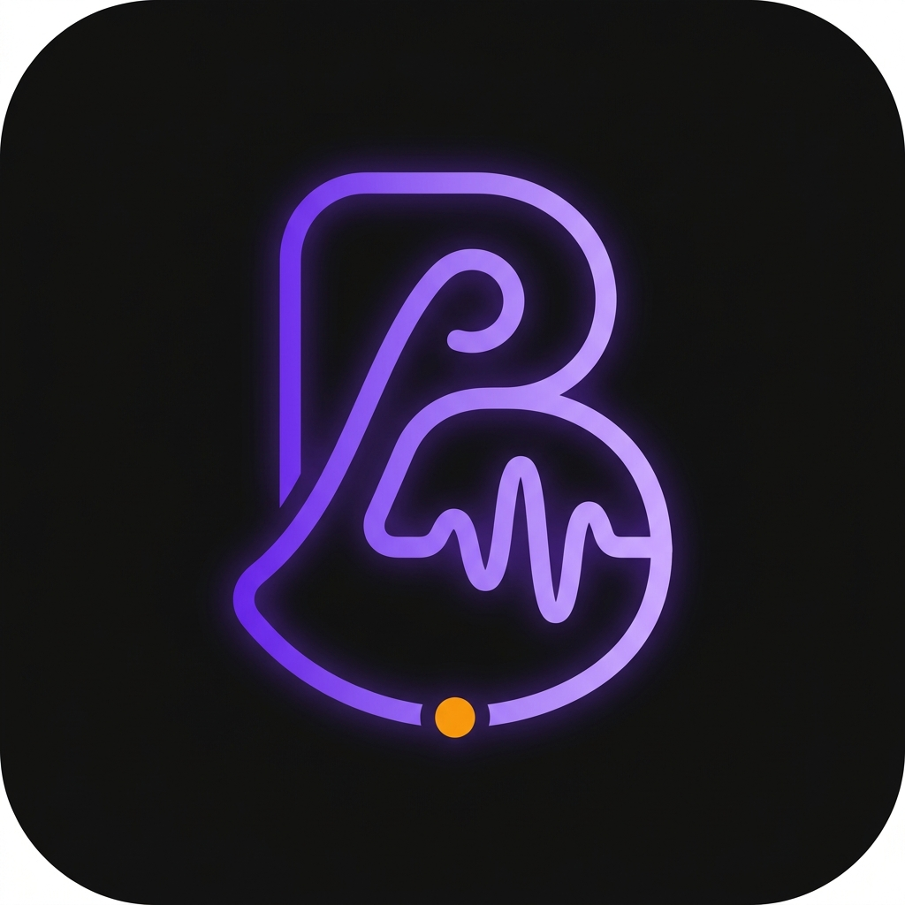

# Beatly 🎵

<p align="center">
  
</p>

<p align="center">
  <strong>Metrônomo Isócrono de Baixa Latência e Gestor de Treino Musical para Praticantes Dedicados</strong>
</p>

<p align="center">
  
  
  
  
  
  
</p>

---

## 📖 Visão Geral

**Beatly** é um aplicativo mobile desenvolvido em Flutter e Kotlin nativo projetado para músicos, instrumentistas e estudantes que buscam precisão rítmica cirúrgica e organização estruturada de suas rotinas de estudo.

Diferente dos metrônomos convencionais baseados em timers de interface (suscetíveis a atrasos causados pela Garbage Collection ou carga de renderização da UI), o **Beatly** utiliza um **motor de áudio nativo em tempo real (`AudioTrack` em Kotlin)** com agendamento direto de amostras PCM 16-bit 44.1kHz, garantindo **jitter zero** mesmo sob uso intenso do dispositivo ou durante transições de telas.

---

## ⚡ Principais Funcionalidades

### 1. Metrônomo Isócrono & Roda 1:1
* **Precisão de Amostra (*Sample-Accurate*)**: O áudio é sintetizado em nível de amostra matemática, mantendo o andamento perfeitamente contínuo e estável.
* **Roda de BPM 1:1**: Disco giratório reativo que segue a ponta do seu dedo em tempo real na tela, permitindo ajustes finos ou grandes saltos de andamento (20 a 300 BPM).
* **Divisões de Tempo**: Suporte nativo para **1x (Pulso)**, **2x (Colcheias)**, **3x (Tercinas)** e **4x (Semicolcheias)**.
* **Controle de Dinâmica por Pulso**: Selecione a acentuação individual de cada tempo do compasso entre **Forte**, **Normal**, **Fraco** ou **Mudo**.
* **Tap Tempo**: Algoritmo com detecção de intervalo médio para captura intuitiva do BPM desejado.

### 2. Modo Desafio de Velocidade
* Acelere gradualmente sua velocidade para treinar passagens difíceis, palhetada, dedilhado ou escalas.
* Configuração flexível: aumento a cada **N compassos** ou a cada **X segundos**.
* Comportamento inteligente ao atingir o teto: **Manter velocidade alvo** ou **Parar + Chime de comemoração**.
* Barra de progresso visual em tempo real no metrônomo.

### 3. Gestor de Rotinas e Atividades de Treino
* Organize treinos diários por categorias com cores Obsidian:
  * 🎯 **Técnica** (Violeta)
  * ⚡ **Velocidade** (Âmbar)
  * 📐 **Teoria** (Azul Claro)
  * 🎸 **Repertório** (Verde Esmeralda)
  * ☕ **Aquecimento** (Ciano)
  * 👂 **Ouvido** (Rosa Claro)
  * 💡 **Criatividade** (Laranja)
* Criação, reordenação e **edição completa** de atividades já existentes.
* Campo de **notas da atividade** (até 100 caracteres) visível durante a execução para orientações de postura, digitação ou foco.

### 4. Execução Imersiva de Treino
* Tela cheia de foco com cronômetro regressivo de alta visibilidade.
* **Transição Suave**: Contagem regressiva antes de iniciar ou trocar de exercício com feedback háptico (*vibrate*) e avisos sonoros (Tigela Tibetana/Zen, Marimba, Gongo).
* **Ajustes On-the-Fly**: Altere o BPM (+1, +5, -1, -5), troque subdivisões ou mute/ajuste volumes dos cliques diretamente durante o treino sem pausar.
* **Persistência e Retomada**: Se sair da tela para consultar uma partitura ou tablatura, o app mantém o treino ativo em background e exibe um banner com botão de **Retomar** imediato.

### 5. Mapa de Evolução & Consistência
* **Radar Pentagonal**: Gráfico poligonal que equilibra o tempo investido em Técnica, Velocidade, Repertório, Teoria e Criatividade.
* **Calendário de Consistência Mensal**: Acompanhe seus dias ativos de prática e métricas totais em minutos estudados.

---

## 🎨 Design System: Obsidian Dark

Interface moderna e confortável para os olhos durante longas sessões de estudo:
* **Background Profundo**: `#0F0F10`
* **Superfície Elevada**: `#18181B` e `#27272A`
* **Destaques**: Violeta Vibrante (`#8B5CF6` / `#A78BFA`) e Âmbar (`#F59E0B`)
* **Tipografia**: Numerais monoespaçados e displays geométricos de fácil leitura à distância do instrumento.

---

## 🏛️ Arquitetura de Software

O Beatly foi construído seguindo rigorosamente os princípios de **Clean Architecture**, **MVVM (Model-View-ViewModel)** e **Ports & Adapters (Hexagonal Architecture)**:

```
lib/
├── app.dart                                # Shell principal com navegação desacoplada e banner de retomada
├── main.dart                               # Ponto de entrada e injeção de dependências
├── domain/                                 # Regras de Negócio e Casos de Uso puros (100% agnóstico a UI)
│   ├── contracts/                          # Ports (ClockPort, MetronomeAudioPort, Repositories)
│   ├── models/                             # Entidades de domínio (Routine, RoutineActivity, Session, etc.)
│   ├── state_machines/                     # Máquinas de estado (RoutineExecutionCoordinator, SpeedChallenge)
│   └── use_cases/                          # Lógicas de cálculo matemático e validação
├── data/                                   # Camada de Dados e Infraestrutura (Adapters)
│   ├── database/                           # Banco de dados local SQLite via Drift
│   ├── daos/                               # DAOs tipados (RoutineDao, SessionDao)
│   ├── repositories/                       # Implementações de repositórios
│   └── services/                           # Áudio nativo, Wakelock, Sistema de Clock monotônico
└── ui/                                     # Camada de Apresentação (Flutter)
    ├── core/                               # Tema Obsidian Dark, paleta, componentes reutilizáveis
    └── features/                           # Telas e ViewModels isolados
        ├── metronome/                      # Metrônomo, Modo Desafio e Widgets
        ├── routine_management/             # Lista e Editor de Rotinas
        ├── routine_execution/              # Player de Treino e Modal de Ajustes
        ├── evolution_map/                  # Radar Chart e Calendário
        └── settings/                       # Preferências e Prévia de Avisos Sonoros
```

---

## 🧪 Portão de Qualidade & Testes Automatizados

O projeto conta com **132 testes automatizados** divididos em:
* **Testes Unitários**: Validação matemática de cálculo de BPM, radar poligonal, integridade de banco de dados e máquinas de estado.
* **Testes de Widget**: Testes de interação de interface com cliques, seletores, bottom sheets e feedback visual.
* **Testes de Integração**: Ciclo de vida completo de uma rotina ponta a ponta (`ITC-08.01`).

Para rodar todos os testes:
```bash
flutter test
```

Para rodar a análise estática:
```bash
flutter analyze
```

---

## 🚀 Como Executar o Projeto

### Pré-requisitos
* Flutter SDK 3.x instalado e adicionado ao `PATH`
* Android SDK (API 24 ou superior)
* Java 17+

### 1. Clonar o repositório
```bash
git clone https://github.com/vterry/beatly.git
cd beatly
```

### 2. Instalar as dependências
```bash
flutter pub get
```

### 3. Gerar arquivos do Drift (Database)
```bash
dart run build_runner build --delete-conflicting-outputs
```

### 4. Executar em modo Debug
```bash
flutter run
```

### 5. Gerar o APK de Produção (Release)
```bash
flutter build apk --release
```
O executável compilado estará localizado em:
`build/app/outputs/flutter-apk/app-release.apk`

---

## 📄 Licença

Distribuído sob a licença MIT. Consulte `LICENSE` para mais informações.
