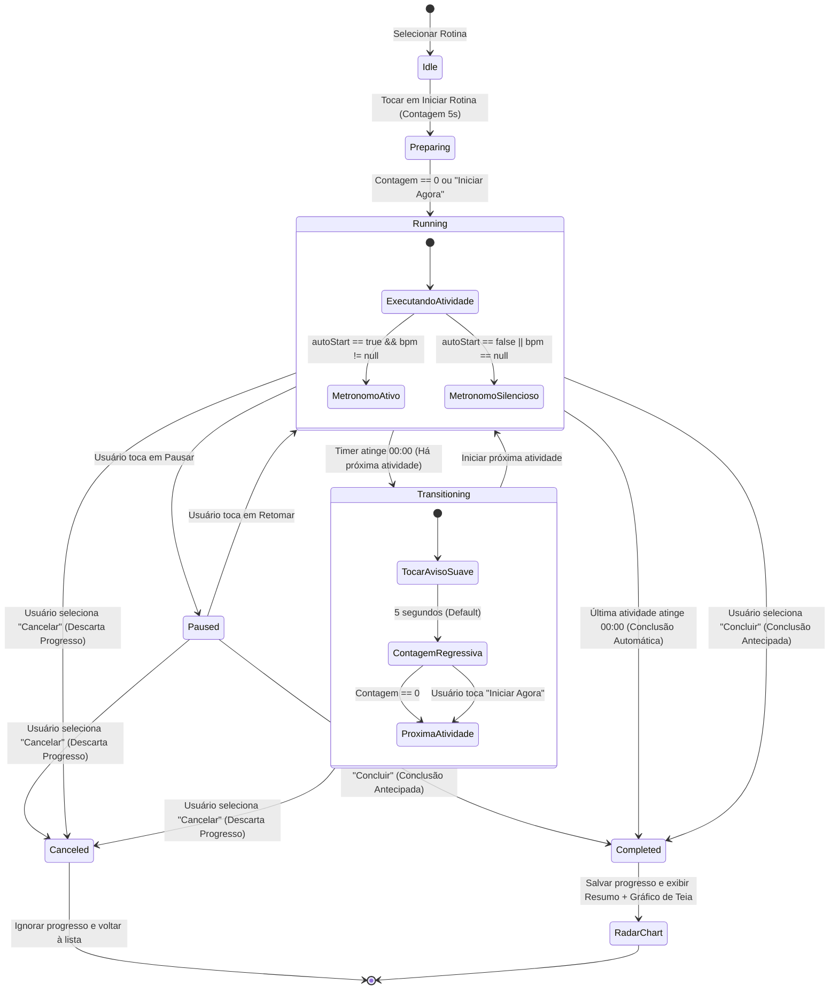
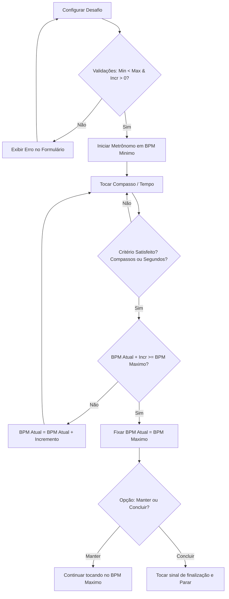

# Beatly — Documento de Especificação Funcional e de Requisitos (SPEC.md)

| Metadado | Detalhe |
| :--- | :--- |
| **Projeto** | Beatly — Assistente Inteligente e Metrônomo de Estudos Musicais |
| **Documento** | Especificação Funcional e Requisitos do Sistema (SPEC.md) |
| **Etapa do Projeto** | Etapa 1 — Refinamento de Requisitos |
| **Versão** | 1.1.0 |
| **Status** | Aprovado pelo Piloto |
| **Público-Alvo (Usuário)** | Músicos (amadores a profissionais) e estudantes de música |
| **Papel do Piloto** | Arquiteto de Software Validador e Operador Antigravity |
| **Stack Base** | Flutter / Dart (Standalone Android, Offline-First) |

---

## 1. Visão Geral do Produto e Glossário

### 1.1. Visão Geral
O **Beatly** é um aplicativo móvel voltado para o aprimoramento da prática e rotina de estudos musicais. Ele integra um **Metrônomo Profissional de Alta Precisão** com **Modo Desafio** (Speed Trainer) e um **Gerenciador de Rotinas de Estudos com Timer Sequencial**, culminando em um **Mapa de Evolução (Radar Chart)** que mapeia o equilíbrio do estudante em 5 categorias essenciais de estudo musical.

O aplicativo adota a filosofia **100% Standalone (Offline-First)**: não exige internet, não possui backend remoto, não solicita login e armazena todos os dados de forma privada e segura no próprio dispositivo Android do usuário.

### 1.2. Papéis e Atores
- **Usuário**: Músico ou estudante que utiliza o Beatly em seu smartphone durante seus treinos diários para cronometrar exercícios, usar o metrônomo e acompanhar sua evolução de estudo.
- **Piloto**: Arquiteto de software validador no ambiente Antigravity, responsável por auditar, aprovar requisitos, orientar a arquitetura técnica e supervisionar os ciclos de TDD e entrega contínua.

### 1.3. Glossário
- **BPM (Batidas Por Minuto)**: Unidade de medida de andamento musical.
- **Fórmula de Compasso**: Notação que indica a quantidade de tempos por compasso e a figura de nota que serve de unidade de tempo (ex.: 4/4, 3/4, 6/8).
- **Subdivisão**: Divisão rítmica interna de cada pulso/tempo (semínima, colcheia, tercina, semicolcheia).
- **Modo Desafio (Speed Trainer)**: Modo automatizado de aceleração gradativa do metrônomo a cada $N$ compassos ou intervalo de tempo.
- **Rotina de Estudo**: Conjunto sequencial e ordenado de atividades práticas de estudo com metas temporais definidas.
- **Atividade**: Unidade atômica de um treino musical contendo nome, classificação, duração dedicada, BPM opcional e regra de auto-start.
- **Categorias Fixas**: Cinco eixos canônicos de estudo: `Técnica`, `Velocidade`, `Teoria Musical`, `Improviso` e `Free Style`.
- **Transição Suave**: Intervalo de preparação e descanso cognitivo entre duas atividades consecutivas, com aviso sonoro suave e contagem regressiva.
- **Mapa de Evolução (Gráfico de Teia / Radar Chart)**: Representação pentagonal dos tempos acumulados em cada uma das 5 categorias, avaliando o equilíbrio do treino na sessão e no consolidado mensal.

---

## 2. Requisitos do Sistema

### 2.1. Módulo 1: Metrônomo e Modo Desafio

#### [RF-01] Controle de Andamento (BPM)
- **Descrição**: O usuário deve poder configurar a velocidade do metrônomo com precisão.
- **Regras de Negócio**:
  - **RN-01.1**: Limites de velocidade: Mínimo de **20 BPM** e Máximo de **300 BPM**.
  - **RN-01.2**: Métodos de ajuste e layout principal do Metrônomo:
    - **Roda Giratória Central (Rotary Jog Wheel / Dial)** em destaque no centro da tela com arco indicador bidirecional superior (`◄─── BPM ───►`), número de BPM em fonte grande e andamento musical (*Allegro*, *Moderato*, etc.) acima da roda, com resposta háptica leve a cada passo.
    - **4 Botões nos Cantos da Roda**:
      - Superior Esquerdo (`|◀`): Decremento rápido/fino de BPM (`-1` ao tocar, `-5` ao segurar).
      - Superior Direito (`▶|`): Incremento rápido/fino de BPM (`+1` ao tocar, `+5` ao segurar).
      - Inferior Esquerdo (`▶` / `⏸`): Play / Pause principal do metrônomo.
      - Inferior Direito (`TAP`): Função **Tap Tempo** (média móvel dos últimos 4 toques consecutivos).
    - Toque direto sobre o número do BPM para digitação numérica direta com validação automática de faixa [20..300].

#### [RF-02] Fórmula de Compasso e Subdivisão do Tempo
- **Descrição**: O usuário deve configurar a métrica rítmica e a subdivisão de cada tempo.
- **Regras de Negócio**:
  - **RN-02.1**: Numerador (pulsos por compasso): configurável de **1 a 16** batidas.
  - **RN-02.2**: Denominador base: 2, 4, 8 ou 16 (default = 4).
  - **RN-02.3**: Subdivisões por pulso:
    - `1` (Unidade de pulso / Semínima equivalente).
    - `2` (Colcheias / 2 toques por pulso).
    - `3` (Tercinas / 3 toques por pulso).
    - `4` (Semicolcheias / 4 toques por pulso).

#### [RF-03] Controle Individual de Volume e Acentuação por Pulso
- **Descrição**: O usuário deve poder customizar individualmente o volume/ênfase de cada batida do compasso diretamente na interface.
- **Regras de Negócio**:
  - **RN-03.1**: Cada batida do compasso possui 4 estados cíclicos ao ser tocada na interface:
    1. **Acento / Forte**: Volume 100%, timbre agudo/acentuado (default na batida 1).
    2. **Normal / Médio**: Volume 70%, timbre padrão de corpo.
    3. **Subdivisão / Fraco**: Volume 40%, timbre leve/suave.
    4. **Mudo**: Volume 0% (silêncio rítmico, preserva a passagem do tempo).
  - **RN-03.2**: Indicador visual luminoso (LEDs virtuais) sincronizado em tempo real com cada pulso sonoro, mantendo visibilidade mesmo com volume em Mudo.
  - **RN-03.3**: Seleção de conjunto de sons (Sound Sets): Woodblock clássico, Beep digital, Click mecânico, Baqueta (Stick click).

#### [RF-04] Modo Desafio (Speed Trainer Progressivo)
- **Descrição**: O usuário deve poder programar sessões de aceleração progressiva contínua para ganho de velocidade e resistência motora.
- **Regras de Negócio**:
  - **RN-04.1**: Parâmetros de configuração obrigatórios:
    - **BPM Inicial ($BPM_{min}$)**: 20 a 299 BPM.
    - **BPM Final ($BPM_{max}$)**: 21 a 300 BPM.
    - **Incremento ($\Delta BPM$)**: 1 a 20 BPM.
    - **Critério de Disparo do Incremento**:
      - Modo A: *A cada $N$ compassos* (1 a 64 compassos).
      - Modo B: *A cada intervalo de tempo* (5 segundos a 10 minutos).
  - **RN-04.2**: Validação estrita de limites:
    - Obrigatoriamente: $BPM_{min} < BPM_{max}$.
    - Obrigatoriamente: $\Delta BPM \le (BPM_{max} - BPM_{min})$.
    - Se a soma $(BPM_{atual} + \Delta BPM) > BPM_{max}$, o novo andamento será travado exatamente no $BPM_{max}$.
  - **RN-04.3**: Comportamento ao atingir o $BPM_{max}$:
    - O usuário escolhe na configuração do desafio:
      - *Opção 1 (Manter)*: Continua tocando no $BPM_{max}$ indefinidamente até parada manual.
      - *Opção 2 (Concluir)*: Toca 1 compasso de finalização, emite sinal sonoro suave de conclusão e pausa automaticamente.
  - **RN-04.4**: Painel visual dinâmico com velocímetro, BPM atual, barra de progresso percentual até o objetivo e contador regressivo para o próximo incremento.

---

### 2.2. Módulo 2: Rotinas de Estudos e Atividades

#### [RF-05] Gestão de Rotinas (CRUD)
- **Descrição**: O usuário deve poder organizar seus estudos criando e gerenciando rotinas (pastas de estudo).
- **Regras de Negócio**:
  - **RN-05.1**: Uma rotina é composta por:
    - Identificador único (UUID).
    - Nome da rotina (obrigatório, 1 a 60 caracteres, ex.: "Treino Matinal de Guitarra").
    - Cor de identificação visual (paleta minimalista estilo Obsidian).
    - Lista ordenada de atividades (mínimo 1, sem limite técnico imposto).
  - **RN-05.2**: O aplicativo deve calcular e exibir automaticamente a **Duração Total Estimada** da rotina ($\sum \text{Duração das Atividades} + \sum \text{Tempos de Transição}$).
  - **RN-05.3**: Reordenação intuitiva de atividades (drag-and-drop ou setas de ordenação).
  - **RN-05.4**: Duplicação rápida de rotina existente para facilitar variações de treino.

#### [RF-06] Atributos e Validação de Atividades
- **Descrição**: Cada atividade dentro de uma rotina deve conter parâmetros precisos de execução.
- **Regras de Negócio**:
  - **RN-06.1**: Campos obrigatórios da atividade:
    - **Nome**: 1 a 80 caracteres (ex.: "Escala Maior em Duas Oitavas", "Arpejos com Salto de Corda").
    - **Classificação**: Seleção obrigatória em lista fechada contendo exatamente:
      1. `Técnica`
      2. `Velocidade`
      3. `Teoria Musical`
      4. `Improviso`
      5. `Free Style`
    - **Duração Dedicada**: Contador regressivo de 10 segundos a 180 minutos (3 horas), com resolução em minutos e segundos.
  - **RN-06.2**: Campos opcionais e de comportamento:
    - **BPM Alvo (Opcional)**: Valor numérico inteiro de 20 a 300 BPM, ou nulo/desativado.
    - **Iniciar metrônomo automaticamente (`autoStartMetronome`)**: Flag booleana (default: `false`).
      - Regra: Só pode ser ativada se um BPM Alvo for informado. Caso o usuário remova o BPM Alvo, a flag é automaticamente redefinida para `false`.
    - **Notas/Instruções da Atividade**: Campo de texto simples (até 500 caracteres) para anotações rápidas (ex.: "Focar em palhetada alternada estrita, relaxar polegar esquerdo").

#### [RF-07] Execução Isolada e Sequencial da Rotina
- **Descrição**: O usuário deve poder executar uma rotina selecionada em modo de foco e imersão total.
- **Regras de Negócio**:
  - **RN-07.1**: Isolamento: Apenas uma rotina pode ser executada por vez. Iniciar outra rotina exige descartar ou concluir a atual.
  - **RN-07.2**: Estados de Execução da Rotina:
    - `Idle` (Não iniciada)
    - `Preparing` (Contagem regressiva inicial de preparação antes da 1ª atividade, usando o mesmo contador configurável de default 5s)
    - `Running` (Atividade em andamento)
    - `Paused` (Pausada pelo usuário)
    - `Transitioning` (Transição entre atividades com contador regressivo)
    - `Completed` (Rotina concluída — seja automaticamente ao fim de todas as atividades, seja manualmente pela opção **Concluir Rotina**)
    - `Canceled` (Rotina cancelada pelo usuário — descarta todo o progresso feito até ali)
  - **RN-07.3**: Controles de Fluxo disponíveis para o usuário durante a rotina:
    - **Pausar / Retomar**: Congela o timer da atividade e cessa o metrônomo imediatamente. Retomar reativa o timer e o metrônomo sincronizados.
    - **Avançar / Pular (Skip Next)**: Encerra imediatamente a atividade atual e aciona a transição para a próxima.
    - **Voltar (Previous)**: Reinicia a atividade atual ou retorna à atividade imediatamente anterior.
    - **Concluir Rotina**: Conclui a rotina imediatamente, não importando quantas atividades ainda faltem. Todo o tempo efetivamente praticado até aquele instante é consolidado, persistido no histórico e a tela de resumo e resultados (Gráfico de Teia) é apresentada.
    - **Cancelar Rotina**: Cancela a execução da rotina imediatamente e **ignora/descarta todo o progresso feito até ali** (nenhum dado é salvo no histórico e a tela de resultados não é exibida, retornando à tela de rotinas).
  - **RN-07.4**: Conclusão Automática:
    - Quando o usuário segue as atividades dentro da rotina e conclui a última atividade, a rotina transita automaticamente para `Completed`, salva os dados e apresenta imediatamente o resumo e resultados (Gráfico de Teia).
  - **RN-07.5**: Tela de Foco do Estudo:
    - Exibição de alta visibilidade: Nome da atividade, Categoria (com tag visual discreta), Cronômetro regressivo com fonte monoespaçada grande, Próxima atividade na fila, controle de BPM rápido (se o metrônomo estiver associado) e ações explícitas de **Concluir** e **Cancelar**.

#### [RF-08] Transição Suave e Alerta Sonoro
- **Descrição**: Ao concluir uma atividade, o Beatly deve avisar o usuário de forma amigável e permitir uma breve preparação cognitiva/motora antes da próxima atividade.
- **Regras de Negócio**:
  - **RN-08.1**: Ao zerar o timer da atividade:
    - O metrônomo é silenciado instantaneamente (se estava ativo).
    - É disparado um **aviso sonoro suave** (ex.: chime harmônico/sino zen, com ataque suave e sem agudos estridentes, para evitar sustos com fone de ouvido ou amplificador).
  - **RN-08.2**: Logo após o aviso sonoro, é iniciada uma contagem regressiva de preparação (tela de transição).
  - **RN-08.3**: Duração da contagem regressiva: configurável nas Configurações Gerais, com valor padrão de **5 segundos**.
  - **RN-08.4**: Botão de atalho: Durante a transição, deve haver um botão explícito **"Iniciar Agora"**, permitindo pular os segundos restantes de descanso se o músico já estiver pronto.
  - **RN-08.5**: Ao zerar a contagem regressiva da transição:
    - A próxima atividade é iniciada imediatamente.
    - Se a nova atividade possuir BPM configurado e `autoStartMetronome == true`, o metrônomo começa a tocar no primeiro milissegundo da nova atividade.

---

### 2.3. Módulo 3: Mapa de Evolução (Local Analytics & Radar Chart)

#### [RF-09] Gráfico de Teia da Sessão (Radar Chart)
- **Descrição**: Imediatamente após a conclusão de uma rotina de estudos, o Beatly deve renderizar um Gráfico de Teia (Radar Chart) pentagonal revelando o equilíbrio de tempo dedicado naquela sessão.
- **Regras de Negócio**:
  - **RN-09.1**: O gráfico possui exatamente 5 eixos radiais, fixos e canônicos:
    1. `Técnica`
    2. `Velocidade`
    3. `Teoria Musical`
    4. `Improviso`
    5. `Free Style`
  - **RN-09.2**: O valor atribuído a cada vértice é o **tempo líquido em minutos** dedicado àquela categoria durante a sessão.
  - **RN-09.3**: A escala do gráfico se autoajusta proporcionalmente ao valor máximo atingido entre as categorias na sessão (garantindo legibilidade mesmo para sessões curtas de 15 minutos ou longas de 2 horas).
  - **RN-09.4**: Destaque e Diagnóstico da Sessão:
    - Apresentar em destaque textual a **Categoria Mais Treinada** da sessão (ex.: *"Foco Principal: Técnica (45 min - 50% da sessão)"*).
    - Apresentar as categorias não treinadas (0 min) para estimular o equilíbrio do estudante.
  - **RN-09.5**: Salvar automaticamente o registro da sessão no banco de dados local com timestamp, rotina utilizada e detalhamento por categoria.

#### [RF-10] Resumo Mensal e Consolidação Histórica
- **Descrição**: O usuário deve poder consultar uma visão consolidada de seu estudo ao longo dos meses.
- **Regras de Negócio**:
  - **RN-10.1**: Seletor de período: Mês e Ano (ex.: `Novembro 2026`), com botões de navegação para meses anteriores/posteriores.
  - **RN-10.2**: Gráfico de Teia Mensal:
    - Vértices representam o somatório total de horas/minutos investidos em cada uma das 5 categorias dentro do mês selecionado.
  - **RN-10.3**: Métricas Analíticas Globais do Mês:
    - **Tempo Total Estudado** (ex.: 28h 45min).
    - **Quantidade de Rotinas Concluídas** (ex.: 22 sessões).
    - **Média Diária de Prática** (ex.: 55 min/dia ativo).
    - **Distribuição Percentual**: Lista com barras horizontais demonstrando o percentual de tempo dedicado a cada uma das 5 categorias.
    - **Ofensiva / Calendário de Consistência**: Mapa de calor dos dias do mês em que houve treino concluído.

---

### 2.4. Módulo 4: Configurações Gerais e Áudio

#### [RF-11] Configuração do Contador de Transição
- **Descrição**: Personalização da cadência entre exercícios.
- **Regras de Negócio**:
  - **RN-11.1**: Seletor numérico (slider ou picker) de **0 a 60 segundos**.
  - **RN-11.2**: Valor padrão inicial de fábrica: **5 segundos**.
  - **RN-11.3**: Caso configurado como `0 segundos`, a transição ocorre de maneira imediata (apenas emite o aviso sonoro e inicia a próxima atividade sem contagem).

#### [RF-12] Personalização de Áudio e Feedback Tátil
- **Descrição**: Preferências para adequação ao ambiente de estudo (fone de ouvido, caixa acústica ou celular mudo).
- **Regras de Negócio**:
  - **RN-12.1**: Volume independente do Alerta Sonoro de Transição (slider de 0% a 100%).
  - **RN-12.2**: Catálogo de Sons de Alerta Suave:
    - Opção A: *Sino Tibetano / Chime Zen* (Padrão).
    - Opção B: *Marimba Suave*.
    - Opção C: *Gongo Meditativo*.
    - Opção D: *Mudo (Apenas vibração háptica)*.
  - **RN-12.3**: Resposta Tátil (Haptic Feedback):
    - Chave Liga/Desliga para vibrar o celular no primeiro pulso do compasso.
    - Chave Liga/Desliga para vibrar no momento da transição entre atividades.
  - **RN-12.4**: Manter Tela Ligada (Wakelock):
    - Chave Liga/Desliga (default: `Ativado`). Impede que a tela do Android apague enquanto uma rotina ou o metrônomo estiver em execução.

---

## 3. Requisitos Não-Funcionais (RNF)

| Identificador | Categoria | Descrição e Critério Técnico |
| :--- | :--- | :--- |
| **RNF-01** | **Standalone / Offline-First** | O aplicativo não deve depender de nenhuma API de rede, serviço na nuvem ou conexão com a internet para executar qualquer funcionalidade. Todo o estado é mantido em banco de dados local persistente (SQLite / Drift ou Isar). |
| **RNF-02** | **Precisão e Baixa Latência de Áudio** | O motor de áudio do metrônomo deve operar com precisão de timing isócrono, com desvio (jitter) máximo aceitável inferior a **$\pm 5\text{ ms}$**. Em Android, o mecanismo de agendamento de áudio deve utilizar streams de baixa latência (via OpenSL ES / AAudio nativo ou gerador de pulsos de áudio de alta prioridade). |
| **RNF-03** | **Plataforma Alvo** | Sistema Operacional **Android** (suporte mínimo a partir da versão Android 8.0 - API 26 até Android 14/15 - API 34+). Desenvolvido nativamente através de framework **Flutter / Dart**. |
| **RNF-04** | **UX Minimalista Estilo Obsidian** | Paleta com predominância de tema escuro profundo (*Deep Dark* `#0F0F10`, `#1A1A1C`, `#242426`), superfícies foscas, tipografia monoespaçada de alto contraste para numerais (`JetBrains Mono` ou `Roboto Mono`) e acentos pontuais sutis (roxo `#7C3AED` e dourado suave `#F59E0B`). Interface focada em evitar distrações visuais. |
| **RNF-05** | **Execução em Segundo Plano (Background Execution)** | O metrônomo e o timer da rotina devem continuar operando sem pausas caso a tela seja desligada ou o usuário minimize o app, recorrendo a um *Android Foreground Service* com notificação persistente de controle (Play/Pause). |
| **RNF-06** | **Desempenho e Eficiência Energética** | O uso sustentado do metrônomo por 60 minutos não deve provocar aquecimento anormal do dispositivo nem consumir mais que 6% de bateria por hora em condições normais de uso. |
| **RNF-07** | **Testabilidade / Orientação a TDD** | Toda a lógica de negócios (máquina de estados do metrônomo, agendamento de transições, validação de limites de desafio e cálculo dos eixos do Radar Chart) deve ser desacoplada da UI e ter 100% de cobertura por testes unitários e de integração de domínio. |

---

## 4. Matriz de Casos de Borda e Tratamento de Exceções

| ID | Cenário de Borda (Edge Case) | Comportamento Esperado do Sistema |
| :--- | :--- | :--- |
| **EC-01** | Usuário tenta salvar Modo Desafio com $BPM_{min} \ge BPM_{max}$. | A interface bloqueia o botão "Iniciar Desafio", destaca o campo com erro visual e exibe a mensagem: *"O BPM Inicial deve ser menor que o BPM Final"*. |
| **EC-02** | O incremento ($\Delta BPM$) do Modo Desafio não é múltiplo exato da diferença $(BPM_{max} - BPM_{min})$. | No último incremento, o sistema soma apenas o valor necessário para atingir exatamente o $BPM_{max}$, sem ultrapassá-lo (ex.: Atual 115, $\Delta BPM = 10$, Max 120 $\rightarrow$ próximo BPM é 120). |
| **EC-03** | Atividade cadastrada com flag `autoStartMetronome = true`, mas sem BPM configurado. | A flag `autoStartMetronome` é ignorada pelo motor de execução. A atividade inicia com o timer regressivo rodando, porém com o metrônomo desligado em silêncio. |
| **EC-04** | Rotina de estudos contendo apenas 1 atividade. | Ao término do tempo da única atividade, o sistema não dispara contagem regressiva de transição, emitindo o aviso de término e navegando diretamente para a tela do Gráfico de Teia (Radar Chart). |
| **EC-05** | Usuário recebe uma chamada telefônica ou áudio de outro app während a rotina. | O Beatly escuta os eventos de perda de `AudioFocus` do Android. Se houver perda transitória, o metrônomo pausa; se permanente, a rotina pausa com estado salvo e notificação para retomar. |
| **EC-06** | Usuário seleciona **Concluir Rotina** antes de terminar todas as atividades vs. seleciona **Cancelar Rotina**. | Ao selecionar **Concluir**, a rotina encerra imediatamente, contabiliza apenas o tempo efetivamente praticado nas atividades até aquele momento, salva no histórico e exibe o resumo/Gráfico de Teia. Ao selecionar **Cancelar**, a rotina é abortada e todo o progresso feito até ali é descartado/ignorado. |
| **EC-07** | Tempo de transição configurado para `0 segundos` nas Configurações Gerais. | A transição é instantânea: o aviso sonoro toca simultaneamente com a inicialização imediata da próxima atividade, sem congelamento de tela. |
| **EC-08** | Mudança de fuso horário ou troca manual de horário do relógio do celular. | O timer regressivo baseia-se em relógio monotônico nativo do sistema (`Stopwatch` / tempo decorrido de CPU), tornando-o imune a alterações no relógio do sistema operacional. |

---

## 5. Critérios de Aceite para Testes (BDD / TDD)

A seguir estão os cenários de teste estruturados no formato `Dado / Quando / Então` (Given/When/Then), prontos para orientar o desenvolvimento orientado a testes (TDD).

### Módulo 1: Metrônomo e Modo Desafio

#### [B-RF-01.1] Alteração de BPM dentro dos limites válidos
- **Dado** que o metrônomo está inicializado em 120 BPM
- **Quando** o usuário clica no botão `+5`
- **Então** o BPM exibido e executado deve ser atualizado para 125 BPM.

#### [B-RF-01.2] Bloqueio de BPM acima do teto máximo
- **Dado** que o metrônomo está em 298 BPM
- **Quando** o usuário clica no botão `+5`
- **Então** o valor deve ser limitado estritamente a 300 BPM e o botão `+` deve ser desabilitado.

#### [B-RF-01.3] Tap Tempo com cálculo de média móvel
- **Dado** que o metrônomo está em repouso
- **Quando** o usuário pressiona o botão `Tap Tempo` 4 vezes com intervalos exatos de 500 milissegundos
- **Então** o BPM calculado deve ser de 120 BPM ($\pm 1\text{ BPM}$).

#### [B-RF-03.1] Alternância de estado do pulso rítmico
- **Dado** que a batida 2 está no estado `Normal` (volume 70%)
- **Quando** o usuário clica sobre a batida 2
- **Então** o estado muda para `Subdivisão` (volume 40%)
- **Quando** o usuário clica novamente sobre a batida 2
- **Então** o estado muda para `Mudo` (volume 0%).

#### [B-RF-04.1] Progressão do Modo Desafio por compassos
- **Dado** um desafio configurado com $BPM_{min} = 100$, $BPM_{max} = 120$, $\Delta BPM = 5$ a cada 4 compassos
- **Quando** o 4º compasso é completado em 100 BPM
- **Então** no início do 5º compasso o andamento sonoro deve mudar imediatamente para 105 BPM sem perda de sincronicidade.

#### [B-RF-04.2] Rejeição de configuração inválida no Modo Desafio
- **Dado** que o usuário preenche $BPM_{min} = 140$ e $BPM_{max} = 120$
- **Quando** o usuário solicita iniciar o desafio
- **Então** o sistema recusa a ação, exibe mensagem de validação e não inicia o áudio.

---

### Módulo 2: Rotinas de Estudos e Transição

#### [B-RF-05.1] Cálculo da Duração Total da Rotina
- **Dado** que uma rotina possui 3 atividades:
  - Atividade A: 10 minutos
  - Atividade B: 15 minutos
  - Atividade C: 5 minutos
- **E** o tempo de transição global está configurado para 5 segundos (2 intervalos de transição)
- **Quando** a rotina é listada ou visualizada
- **Então** a duração total calculada deve ser de 30 minutos e 10 segundos.

#### [B-RF-06.1] Restrição de Classificação Canônica
- **Dado** o formulário de cadastro de nova atividade
- **Quando** o usuário inspeciona as opções de categoria disponíveis
- **Então** devem existir exclusivamente as 5 opções: `Técnica`, `Velocidade`, `Teoria Musical`, `Improviso` e `Free Style`.

#### [B-RF-06.2] Dependência de BPM para Auto-Start do Metrônomo
- **Dado** que uma atividade está sem BPM definido (campo nulo)
- **Quando** o usuário tenta marcar o switch `Iniciar metrônomo automaticamente`
- **Então** o aplicativo deve desabilitar o switch ou exibir aviso instruindo a definir um BPM primeiro.

#### [B-RF-07.1] Auto-Start do Metrônomo ao iniciar a atividade
- **Dado** uma atividade configurada com 140 BPM e flag `autoStartMetronome = true`
- **Quando** a atividade é iniciada
- **Então** o timer regressivo entra em contagem regressiva e o metrônomo começa a emitir cliques em 140 BPM simultaneamente.

#### [B-RF-08.1] Disparo de transição suave ao esgotar o tempo da atividade
- **Dado** uma atividade em execução com 00:01 restante e metrônomo ligado
- **Quando** o cronômetro atinge 00:00
- **Então** o metrônomo para instantaneamente de emitir som
- **E** o aviso sonoro suave é reproduzido
- **E** o contador de transição regressivo inicia em 5 segundos.

#### [B-RF-08.2] Aceleração da transição pelo usuário
- **Dado** que a rotina está em fase de transição exibindo 4 segundos restantes
- **Quando** o usuário toca no botão `Iniciar Agora`
- **Então** a contagem de transição é interrompida imediatamente e a próxima atividade começa no mesmo instante.

#### [B-RF-07.2] Conclusão Automática da Rotina ao finalizar todas as atividades
- **Dado** que o usuário está executando a última atividade de uma rotina
- **Quando** o cronômetro da última atividade atinge 00:00
- **Então** a rotina é concluída automaticamente (`Completed`), o progresso é salvo e a tela de resumo e resultados (Gráfico de Teia) é apresentada imediatamente.

#### [B-RF-07.3] Conclusão Manual Antecipada da Rotina ("Concluir")
- **Dado** que uma rotina de 4 atividades está em execução na 2ª atividade
- **Quando** o usuário seleciona a opção `Concluir`
- **Então** a rotina é concluída imediatamente (ignorando as atividades restantes não realizadas), o tempo praticado até aquele momento é salvo e a tela de resumo e resultados (Gráfico de Teia) é apresentada.

#### [B-RF-07.4] Cancelamento da Rotina com Descarte de Progresso ("Cancelar")
- **Dado** que uma rotina está em execução (ou pausada) com 15 minutos já praticados
- **Quando** o usuário seleciona a opção `Cancelar`
- **Então** o metrônomo e o timer param imediatamente, todo o progresso feito até ali é descartado (não é salvo no banco de dados) e o aplicativo retorna à tela de listagem de rotinas sem exibir tela de resultados.

---

### Módulo 3: Mapa de Evolução e Analytics

#### [B-RF-09.1] Exibição do Gráfico de Teia ao concluir rotina
- **Dado** que o usuário concluiu uma rotina de 45 minutos com:
  - 20 min de `Técnica`
  - 15 min de `Velocidade`
  - 10 min de `Teoria Musical`
  - 0 min de `Improviso`
  - 0 min de `Free Style`
- **Quando** a última atividade termina
- **Então** o aplicativo exibe o modal do Gráfico de Teia (Radar Chart)
- **E** os 5 eixos exibem respectivamente os valores 20, 15, 10, 0 e 0
- **E** a categoria `Técnica` é destacada como a mais treinada (44.4% do tempo).

#### [B-RF-10.1] Consolidação do Resumo Mensal
- **Dado** que no mês de Novembro/2026 foram concluídas 3 rotinas com 30 minutos de `Improviso` cada
- **Quando** o usuário abre a aba "Mapa de Evolução" no mês de Novembro/2026
- **Então** o total acumulado do eixo `Improviso` deve ser de 90 minutos (1h 30min)
- **E** o número de sessões concluídas deve ser exibido como 3.

---

## 6. Fluxos de Interação do Usuário (Diagramas)

### 6.1. Ciclo de Execução da Rotina de Estudos

### 6.2. Fluxo do Modo Desafio (Speed Trainer)

---

## 7. Decisões Validadas e Aprovadas pelo Piloto

As seguintes decisões técnicas e de produto foram validadas pelo **Piloto** para orientar a **Etapa 2 (Refinamento de Arquitetura - ADR.md)** e a implementação em TDD:

### Decisão 1: Controle de Conclusão vs. Cancelamento da Rotina
- **Regra Definida pelo Piloto**:
  1. **Conclusão Automática**: Ao concluir todas as atividades da rotina, ela é concluída automaticamente e exibe a tela de resultados (Gráfico de Teia + resumo).
  2. **Opção "Concluir"**: Disponível durante o controle da rotina; conclui a rotina imediatamente independentemente de quantas atividades faltem, consolidando o progresso realizado até ali e apresentando o resumo e resultados.
  3. **Opção "Cancelar"**: Disponível durante o controle da rotina; cancela a rotina imediatamente e **ignora/descarta todo o progresso feito até ali**.
  4. **Preparação Inicial**: Ao iniciar a rotina, aplica-se a contagem regressiva configurável (padrão 5s) antes da 1ª atividade.
- **Status**: `[Aprovado pelo Piloto]`

### Decisão 2: Mecanismo de Áudio Nativo para Baixa Latência no Android
- **Contexto**: Timers em Dart puro (`Timer.periodic`) estão sujeitos a pausas do Garbage Collector e agendamento de threads do sistema operacional, causando jitter audível em BPMs rápidos.
- **Decisão**: Adotar arquitetura de motor de áudio isócrono de baixa latência (síntese/agendamento de pulsos PCM de alta precisão no Android) para garantir variação menor que 5ms.
- **Status**: `[Aprovado pelo Piloto]`

### Decisão 3: Banco de Dados Local para Standalone
- **Contexto**: O Beatly será 100% offline, exigindo banco local performático e tipado para Dart/Flutter.
- **Decisão**: Utilizar **Drift (SQLite)** para persistência relacional tipada, consultas de agregação mensal por categoria e suporte nativo a testes unitários em memória para TDD.
- **Status**: `[Aprovado pelo Piloto]`

### Decisão 4: Biblioteca de Renderização do Gráfico de Teia (Radar Chart)
- **Contexto**: Renderização do pentágono com 5 eixos e área translúcida preenchida.
- **Decisão**: Implementar via `CustomPainter` nativo do Flutter para controle visual absoluto no tema *Obsidian Dark*, zero dependências externas de gráficos e alta testabilidade.
- **Status**: `[Aprovado pelo Piloto]`

---

## 8. Próximos Passos
Após a aprovação desta especificação pelo **Piloto**:
1. **Etapa 2**: Criação do Documento de Decisão de Arquitetura (`ADR.md`).
2. **Etapa 3**: Elaboração do Mapa de Implementação Incremental orientado a TDD.
3. **Etapa 4**: Especificação de UI/UX minimalista Obsidian Dark e prototipação de telas.
4. **Etapa 5**: Criação do logotipo e ativos visuais do aplicativo.
